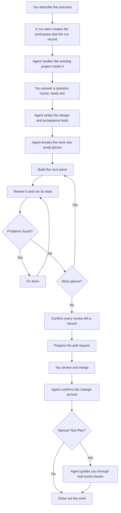
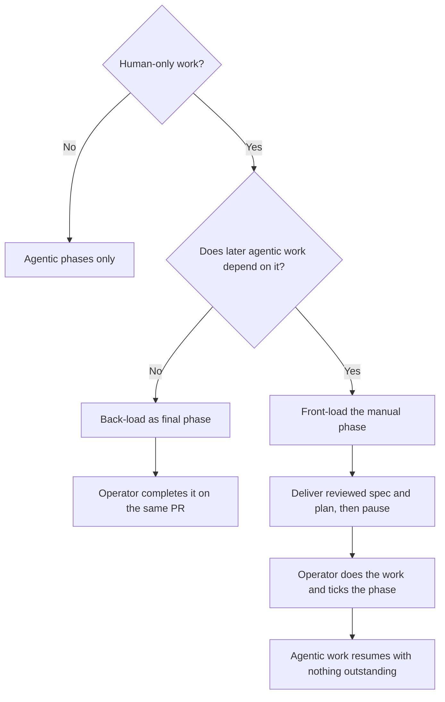

## What does fr-goal do?

Imagine you hand a capable development team a short description of a feature.
The team studies the existing product. It asks a round of questions sized to
the decisions it found (rarely a second, and never a third). Then it designs,
builds, tests and reviews the change. You come back when a pull request is
ready for your review. `fr-goal` gives an artificial intelligence (AI) coding agent
that shape of responsibility.

The important idea is not "the agent writes code by itself." The important
idea is that the agent owns the **whole journey** from an outcome to a reviewed
change. It does not keep asking you to approve documents or to tell it to
continue. Instead, it works in small loops: build something, check it, fix what
the check finds, then continue.

The run writes the journey itself down. A **workflow shape** is a small YAML file
that lists the steps of a run. The steps are: brainstorm, review the spec,
plan, review the plan, implement (with a review inside every phase), confirm
every review left a record, review the whole change through its lenses, and
deliver. `fr-goal` reads that file; the sequence is not in its own prose.

Ask
for `fr-goal` with no argument and it runs the shape this article describes:
feature delivery, test first. Name one, as in `fr-goal ux-research`, and it
runs a different shape. A project can write shapes of its own. It can also
replace a shipped one: it saves a file of the same name in its own repository,
and the tool that runs them stays as it is.

That autonomy begins with a hard physical boundary, and the boundary exists
before the first step of the shape runs. The run does not set it up as a step;
it gets it ready-made. **`fr run start` creates the isolated workspace**: a
separate Git worktree, plus the project's development container. Only then does it write
down that a run exists. Everything after that happens inside it.

Autonomous
work does not happen in the original checkout. Where the project uses
containers, a missing container profile stops the run; the guarantee does not
quietly get weaker.

A run also keeps a **durable record of its own progress**. A file on the feature
branch says which step the run is on, what each finished step produced, and
whether the run is waiting on you. Without that file, all of this would live in
the conversation and end with it: interrupt the run, and the thread is gone.
With it, you can ask where a run got to and pick it back up. You can also read
afterwards, in the pull request next to the code, what happened in what order.

Verification also happens at two levels. **Acceptance tests** gather evidence
that the promised user-visible behavior works while the agent builds the
feature. For a deployed change, a separate **manual Test Plan** checks the
result in the real environment after merge. The agent does not merely leave
that plan in the pull request. It returns after the merge and walks the
operator through it.



This is autonomous work, not blind work. `fr-goal` stops when a choice belongs
to you, when an action needs human access, or when it meets a blocker it
cannot safely resolve. It never reads an unanswered question as consent
(`plugins/super-fr/skills/fr-goal/SKILL.md:14-27` and §1). The reviews shown above are
agent-driven, and the pull request discloses them. You still do the human
review and decide whether to merge.

## When should you use it?

Use `fr-goal` when you know the outcome you want and want the agent to own the
delivery process. Do not use it merely to get a design suggestion or a
one-file edit. A useful request states the outcome first. It uses the rest of
the prompt for constraints that are specific to this feature:

```text
/fr-goal Add import and export of saved dashboard filters.
Preserve existing filters, use a documented JSON format, and include migration tests.
```

The command itself already means "size the questions to the decisions, work
autonomously, and take this to a pull request." If you repeat that contract,
you waste the most useful part of the prompt. Add business rules,
compatibility requirements, examples or known risks instead.

Because the pipeline is a shape, the command also takes an optional shape name.
`/fr-goal` runs the feature-delivery shape this article describes.
`/fr-goal <name>` runs another one that the project or the plugin provides
(`plugins/super-fr/skills/fr-goal/SKILL.md:14-27`). Most requests never need
the argument. When you use it, nothing in the rest of this article changes:
the machinery is the same, and only the list of steps differs.

The skill also recognizes `/goal` and natural-language requests such as "build
this autonomously" or "take this to a PR"
(`plugins/super-fr/skills/fr-goal/SKILL.md:1-10`). Use interactive
`fr-brainstorming` instead when you want to shape the design together over
several conversations. `fr-goal` also requires the repository's isolated
development environment. If nobody has set that up, it pauses and offers the
setup interview; it does not work directly on your machine
(`plugins/super-fr/skills/fr-brainstorming/SKILL.md:23-53`).

## How does the workflow fit together?

The simple loop above combines several narrower super-fr features, and the
combination itself is a file you can open. Each feature solves a different
failure:

- damage to the original checkout;
- building the wrong thing;
- losing track of unfinished work;
- hiding human-only steps;
- a skipped review that looks identical to a clean one;
- a merge before review fixes arrive;
- cleaning up before the change is actually present.

The next two sections describe the file that orders those features and the
record that tracks them. The numbered sections after them introduce each
feature at the point where it joins the whole.

### Why is the pipeline a manifest and not a script?

Here are two steps from the shape that runs when you ask for `fr-goal` with no
argument (`plugins/super-fr/workflows/fr-goal.yaml`):

```yaml
workflow: fr-goal
unit: run
requires: [git, tests, scm]

steps:
  - id: brainstorm
    kind: agent
    skill: super-fr:fr-brainstorming
    gate: operator
    emits: [spec, journal:spec, acceptance]

  - id: plan-review
    kind: cli
    run: fr plan self-review {{ artifacts.plan }}
```

Three ideas in that fragment do most of the work.

**A step declares its kind.** `kind: cli` marks a deterministic command. `fr`
runs it directly and the exit code is the verdict. Nothing interprets the
result, and nothing negotiates with it.

`kind: agent` marks judgment work, and
`fr` does not run those steps at all. It prints a brief that says which skill
or agent should do the work, what that work needs and what it must produce.
The coding agent does the work, and then fr records the outcome back into the
run.

We separated the two kinds on purpose. It keeps the engine a plain program:
you can read it, re-run it and get the same answer. It also means every
unpredictable part of the pipeline happens on the far side of a clearly marked
handoff, where a human can see it. No path through the engine could call a
language model, even by accident.

**A step can carry a gate.** `gate: operator` means the run stops there until a
person answers. The shipped shape declares exactly one such gate, on the
question round or rounds. That is the single operator touchpoint the pipeline
promises, whether it takes one round or (rarely) two. An unanswered round is a
stop, not a timeout with a default.

On Claude Code the tool checks that the
stop really happened: to clear the gate, the session's transcript must hold an
answered question since the run paused there. The run record also states how
many rounds the agent asked and why, and the tool checks that against the
transcript too. It refuses a second round nobody was told about, and it
refuses a third one outright. When the gate did take two rounds, the pull
request says so.

An agent may decide that the request already settled everything. It can then
clear the gate without asking, but only if it writes down why, and that reason
lands in the pull request. Where the tool cannot read the transcript, it says
the gate is only advisory; it does not imply that it enforces it.

The same rule, *evidence you did not write yourself*, governs the two other
places where a run could vouch for its own work. A phase's review has to name
the separate reviewer that did it, and never the agent that wrote the code.
Delivery has to name the log of a test run the orchestrator did itself, not a
report it got from a helper. The tool can confirm who wrote that log and when.
It cannot confirm that the command was a real test suite. That check aims at a
relayed "all green", not at deliberate forgery.

The suite may be too slow to run where the agent is (a small cloud container,
say). Then a phase or delivery may name the forge's CI instead, and the tool
reads the checks itself. It wants the checks the repository names as its gate,
each finished green on the pushed commit. Nothing may be left uncommitted or
unpushed, and an open pull request must not conflict.

CI tested your branch
merged into its base, not your branch alone, and the record says so by naming
both commits. While CI is still running, the tool says to come back later and
records nothing. It never takes "CI will pass" on trust.

A user-visible UI requirement asks for the same kind of evidence, in its own
shape. Its acceptance row names the states and the controls it has to cover.
The executor, the reviewer and delivery each open their own screenshots, never
someone else's. The tool confirms this straight from the transcript; it does
not take it on trust.

A script's pass or fail is not enough by itself. Where a
script can drive the interface reliably, it is still worth writing, because it
makes every later rerun cheap: one command, then a look at what it produced.
You no longer pay to re-drive the interface by hand each time. The tool checks
coverage and opening: every named state and interaction has a screenshot, and
a real agent actually looked at it. It never checks what the picture shows;
judging that stays the reviewer's job.

**A step declares what it needs and what it emits.** Artifacts have names:
`spec`, `plan`, `pr`. A later step can therefore find the specification an
earlier step wrote. The tool can also tell whether the inputs a step depends on
actually exist before it dispatches anything anywhere.

The tool looks up shapes in one order: your repository's
`docs/superpowers/workflows/<name>.yaml` first, then the copy shipped with the
plugin. A repository file of the same name replaces the shipped shape whole.
There is no field-by-field merging, and that is a decision, not an omission. A
list of steps that is half yours and half the plugin's fails in ways that are
very hard to see.

`fr workflow check` validates a shape before you rely on it.
It checks that step ids are unique, that there are no cycles, that every
`needs` can be met, and that capabilities come only from a known list. A typo is then an error you see, not a
step that quietly never runs
(`docs/superpowers/implemented/specs/2026-08-14-workflow-shapes-and-workitem-dispatch-design.md`,
section 4.A).

**A second shape ships beside it, for small goals.** Much of what a run costs
stays the same: it does not shrink when the goal does. On a goal that fits in one
phase, those fixed costs were most of the bill.

`fr-goal-light`
(`plugins/super-fr/workflows/fr-goal-light.yaml`) is the same pipeline with
one review stage fewer before any code exists. The agent writes the plan
first. Then a single reviewer reads the specification and the plan together.
`fr-goal`, by contrast, reviews the specification first and the plan in a stage
of its own. The per-phase code review stays.

You can start there with `fr run start fr-goal-light`. More often the question
round decides it: the brainstorm's record says `shape: fr-goal-light`, and the
run moves onto the lighter shape. fr allows that only at the first step,
before anything else has moved. The new shape must also begin with that same
step. The light `plan` step then refuses a plan with more than one
agentic phase and names them. So fr checks "this goal is small" when the agent
writes the plan; it is not a hope carried through the run
(`docs/superpowers/implemented/specs/2026-09-29-fr-goal-light-path-design.md`, section A).

### How does the run keep its place?

Starting a run creates `docs/superpowers/runs/<run-id>.yaml` inside the isolated
workspace. It holds the shape's name, the branch and the **cursor**: the step
the run is on now. It also holds one record per step, with its state (pending,
running, blocked on a gate, done or failed) and the paths of whatever that step
produced.

Six commands move it:

- `fr run start` begins a run.
- `fr run status` prints where it is.
- `fr run advance` executes the step under the cursor if it is a command, or
  prints the dispatch brief if it is agent work.
- `fr run claim` records which agent took that brief.
- `fr run resolve` records how a dispatched step turned out and answers an
  operator gate.
- `fr run check` fails loudly when the cursor sits on a failed step.

Both `check` and `status` also show completed work whose required evidence is
missing as visible debt. That does not change the check's exit code.

Resolving a step is **one call**, and that is a cost decision, not a tidy one.
Every command an agent runs is a turn, and every turn re-reads its whole
context. A phase whose bookkeeping took six separate commands (tick, tick,
journal, journal, resolve, commit) paid for its context six times over. It
paid to write things `fr` could have written in one go.

So each agent step now
keeps a **step record**: a small YAML file under
`docs/superpowers/runs/<run-id>.records/`. The dispatch brief hands it over
pre-filled (and `fr pickup` shows it), with only the sections that step may
carry; the shape's own `emits:` decides which. The agent adds ticks, journal
entries, finding resolutions and evidence as the work happens. It commits the
file with its work. Then `fr run resolve <run-id> --step <id> --record <file>`
applies all of it: it validates it, gates it exactly as before, writes it in
one commit and reports in one line.

A record that `fr` refuses changes nothing on disk. And because the agent
commits the half-filled record, a session that dies mid-phase leaves it for
the next one. `fr pickup` reports it as *record in progress*, and the next
session does not start over. The older one-thing-at-a-time commands still
exist, for you and for runners; they now go through the same engine.

Advancing twice does not hand out the same work twice. The step under the
cursor may already be running: the orchestrator dispatched an agent, and it
has not reported back. Then `fr run advance` refuses and names when that dispatch happened. It
gives you two ways forward: resolve the step, or, if you are sure the agent is
truly lost, `fr run advance <run-id> --redispatch` to re-issue the brief on
purpose.

The refusal matters more than it might seem. Agent work is a natural
place for one conversation to end and another to begin, and advancing is the
obvious first move on the way back in. Without the refusal, the second advance
would print a brief identical to the first, and two agents would edit the same
worktree at once.

`--redispatch` re-issues the brief for the unit that is outstanding and
nothing else: it never selects a different unit. It refuses in turn when
nothing is running at all. If you reach for it then, your picture of the run
is wrong, and it is more useful to say so than to behave quietly like an
ordinary advance.

One more command creates a run instead of moving one. You may have upgraded
your `fr` while a plan was already half-implemented. That work predates the run
model and has no cursor at all. `fr run adopt <plan-dir>` rebuilds one from
what is already on disk: which phases the work finished and which spec the plan
came from. The plan then rejoins the pipeline; it does not stay stranded
outside it.

The upgrade only ever *offers* adoption. It prints the command and adopts nothing
for you, because an unrelated command should not quietly add tracked files to
your repository.

A run may already exist but have started against an older shape, one that has
since gained or lost a step. That is a different problem, and if you move its
file aside by hand, you lose what it knew. `fr run reshape <run-id>` previews
moving it onto the current step list (and `--yes` applies it) when that loses
nothing the run recorded. When it cannot, `fr run adopt <plan-dir> --supersede`
replaces the run with a freshly adopted one. It carries forward the gate
answers, the emitted artifacts, and every unit with its attempts and evidence.
It closes an attempt that is still open as abandoned, and the preview names
whose work that cuts off before you pass `--yes`.

A phase's review may already sit in the plan journal. Someone wrote it before
the cursor existed and after the work it reviews. Then fr adopts that phase with the review
marked `done` as a *historical* review. It says nobody observed the reviewer,
and the PR body lists every such phase by name so you can check them.

Two details make this more than bookkeeping. First, a failed step **does not**
move the cursor. Success advances and failure stays put, so a stalled run keeps
reporting the same step until someone deals with it; it does not slide past
it.

Second, fr commits the file on the feature branch; it does not keep it in a
scratch directory. That is why the run arrives in the pull request with the
code. A reviewer can see which steps ran, what each one emitted and where the
run paused, without having been there. When you archive the plan after merge,
its run record goes to the archive with it.

### Who is holding this phase right now?

That question sounds like idle curiosity until a phase has run for an hour and
you cannot tell whether the agent doing it is alive. It came up for real. The
orchestrator dispatched eight phase executors across two runs. Hours later the
harness still listed one of them as running, and the run record could not say
whether that was a stuck agent or an accounting artifact.

So fr now writes down a dispatch as it happens. When `fr run advance` prints a
brief, it records that it did. It records the kind of agent the brief was for,
the model the phase's difficulty tier resolved to, the harness that resolved
it, and the moment it went out. A tier does not resolve to a model in the
abstract; it resolves *for* a particular harness. So the record keeps the two
together, and a model never sits there with nothing to explain where it came
from.

What `fr` cannot know is *which* agent picked the brief up, because only the
orchestrator that dispatched it ever sees that identifier. That is what
`fr run claim <run-id> --step <step> --item phase/<n> --agent <id>` is for. The
orchestrator calls it right after it dispatches, not when the agent returns.
An identity that only arrives on the way back cannot answer a question you have
while you wait. `fr run status` then shows each phase with its holder and since
when. `fr run check` counts dispatches that are still open, or that nobody
claimed, as visible debt, not as errors.

That point about timing is true of some harnesses and not of others, and the
first live run on a second harness showed it. On some harnesses, dispatching
hands back an identifier at once and lets the agent work in the background.
There you claim while you wait, exactly as described. On others the dispatch
call *blocks*: it does not return until the agent has finished, and the
identifier comes back with the result. There is no moment in between to claim
in. fr still opens the record, still writes down the harness and the model,
and still refuses a second dispatch.

But while the phase runs, the honest
answer to "who is holding this" is *an unclaimed agent on this harness*, and
the name only arrives afterwards. The tool now says which harness is which. It
no longer describes the better case as if it were the only one.

On OpenCode, one party does know the name while the phase runs: the agent
doing the work. Its session has an identifier from the start, and so does the
agent it runs as, which is where the tier lives
(`fr-phase-executor-mechanical`). So the super-fr plugin runs
`fr run claim --open-unit` with both on that session's first tool call. It
names no step, because the child does not know one.

`fr` claims the single
open, unclaimed unit dispatched to that agent. It refuses when none
fits or when more than one does. That refusal stops an unrelated helper agent
from claiming a phase it never held.

The same run also stopped trusting inherited environment variables. An
OpenCode started from a Claude Code shell carries Claude Code's markers, and
`fr` used to believe them. It now names the harness nearest to it in its own
process tree. It records a session only when that harness owns the session
variable it read.

That session also lets `fr` check a few things on OpenCode that it could only
take on trust before. OpenCode itself hands the calling session's identifier to
every shell command it runs. `fr` climbs from it to the top-level session, the
run's own, because a child that runs the command still acts for the run. From
that session `fr` reads what the gates ask about:

- whether the operator really answered the questions you put through
  OpenCode's question tool (a dismissed question is no answer);
- whether the reviewer you name is an agent the run dispatched;
- whether the session that owes a unit's screenshots opened them.

Sometimes it cannot read the session: an OpenCode 1.x session, or a database
it cannot open. Then it does not guess. It asks you to say who answered the
gate, and there is no default any more. It reports your word as a claim:
"cleared by the agent, as claimed, unobserved". When it did watch, it prints a
flat sentence instead.

One more limit applies to what the record may say: fr writes a model down only
when the tool has *seen* it. A tier binding says which model a dispatched phase
*should* get, and that is a promise, not an observation. For a while the tool
wrote the tier's model beside steps the orchestrating agent did itself. The
archive of this very project holds seven reviews credited to a model that did
not do them.

Now the tool reads the session's own transcript, where every reply
names the model that produced it. A dispatched phase records the model that
actually served it, not the alias it asked for. It keeps the tier and the
model bound to that tier beside it, so you can compare the two and neither
overwrites the other. A step the orchestrator ran records the orchestrator's
model. If you bind an `orchestrator` model and the session runs on something
else, every `fr run advance` warns you. It never blocks: which model you run is
your call.

The same record doubles as a lock. Ask `fr run advance` to brief a phase whose
dispatch is still open, and it refuses: exit code 2, naming the holder,
printing no brief at all. That refusal matters more here than elsewhere,
because every phase executor works in the *same* isolated worktree. fr denies
it a worktree of its own on purpose. A second worktree would strand it on the
main branch, where the spec and plan do not exist yet. Two executors briefed
for one phase would therefore be two writers in one checkout, with nothing
else between them.

When an executor really is not coming back, two named moves get you out; you
do not have to improvise one. `fr run claim … --abandoned` closes the record
without resolving the step, so the phase is free and the next `fr run advance`
briefs it again. `fr run advance <run-id> --redispatch` does the closing and
the re-briefing in a single step.

Neither move erases the previous holder. The
records pile up per phase, oldest first. So the pull request carries the whole
history of whom the run asked to do what. That includes the abandoned attempt,
which is usually the one worth reading.

### What did that phase cost, and who spent it?

There is one record per phase and every attempt lives on it. A phase that fr
had to dispatch twice keeps both; the retry does not overwrite what came
before. `fr run status` shows who held each attempt and since when. It shows no
cost: the run's usage file, described below, keeps what a run spent, and
`fr run cost` prints it. Cursors written before that change carried a
per-attempt estimate and measurement; those survive only in the frozen older
cursor shapes.

fr refuses a measurement more often than you might expect, and each refusal is
a fact, not a gap. The transcript fr measures an attempt from lives on the
machine that ran it, under the session that dispatched it, and neither travels
with the branch. So you might push a run mid-phase and pick it up on another
host. That attempt's cost then reads *not observable from here*, not zero.
`fr` will not fall back to a time window and quietly charge you for whatever
else happened to run inside it.

That refusal carries better news than the cost does. A holder dispatched from
a session this one cannot see may well have died with its host. So
`fr run advance` says exactly that when it refuses, and you are not left
waiting on it; `fr run claim … --abandoned` is the way on. Re-briefing then
starts from the last commit, because uncommitted work did not travel either.

Phases are only part of the bill. The orchestrator (the session you started,
which brainstorms, reviews and delivers) spends tokens of its own at every
step. Only the transcripts write any of it down, and they do not survive.
Someone tears down a pod, the harness prunes a session, or you pick a run up
on another machine.

So `fr` captures the run's usage once per host into
`docs/superpowers/usage/<run-id>.yaml`. It does this at `deliver`, and on the
first resolve a new host makes. fr commits the file beside the cursor and
archives it with it. It holds figures per session, per model and per step,
with dollars where the harness reports them. It holds no hostname, path or
message content.

`fr run
cost <run-id>` prints it as two tables on any checkout that has the file,
including one that never ran the run. The first table has a row per step. It
splits each step into what the orchestrating session spent itself and what its
subagents spent: turns, cache-read and output tokens, and dollars for each.

The second table has a row per phase. It shows the tier fr dispatched it at
and the model bound to that tier. It shows the model that actually ran (marked `≠` when the model that ran is from a
different family than the bound one). It also shows what the executor, the
reviewer and the orchestrator each spent on that phase.

The same honesty rule applies: a figure nobody could observe prints `—`, never
`0`. So does the model that ran on a phase recorded before the tool kept the
binding and the observation apart. Back then one field held whichever value
came last, so it cannot say which it was. Sometimes you want to know where
the money went, not how much there was: bookkeeping against implementation,
or before a process change and after it. The `fr-audit` skill
(`fr usage report`) rebuilds that from the harness's own session data.

### What happens when a turn ends on a run that is waiting for nobody?

The loop has one failure that no amount of recorded state can fix, because it
is not a state problem. An executor finishes and reports back, and the report
arrives as a message. The natural, polite reply to a report is to summarize it
and stop. Do that mid-run and nothing breaks. The record is intact, the
cursor is exactly where it should be, and the next command is obvious.

The run
simply stops, waiting for a person who believed it was still going. This
happened three times in a single day before we took it seriously.

We did two things about it, and it is worth being clear which is which.

The
first is wording. The skill now says that an iteration *ends on a dispatch*,
not on a report. You review, fix, push and record the review. Then, in the same
turn, you advance and brief the next phase, and you report afterwards, not
instead. That is the weak fix. It is also the portable one, because it works
wherever an agent reads the skill.

The second is a mechanism, and it catches the consequence, not the
inclination. `fr run check --idle` asks one question: is this run advanceable
with nobody working on it? It answers that question the same way everywhere.
When the answer is yes, it exits with a distinct code and names the command
that would move the run along.

A legitimate stop is not idle. That covers a
run waiting on your answer, a manual phase, a failed step, a finished run, and
above all a phase an executor is *still working on*. A turn that ends while a
background agent is busy is exactly right, and nothing interferes with it.

What each harness can do with that answer differs, and fr declares the
difference; it does not smooth it over. On Claude Code a stop-time hook can
refuse to let the turn end and hand the next command back, and that is what it
does. It does so at most once per position in the run. A command that keeps
failing therefore cannot trap the session in a loop, and to stop on purpose you
only need to stop a second time.

On OpenCode nothing can refuse a stop at all.
There the plugin continues the session with that command instead. That is weaker than a
refusal, and fr records it as weaker. We proved it on a live OpenCode session
in October 2026, and fr declares it enforced. Where no adapter exists, the wording
above is all there is.

The Claude Code guard costs two things worth knowing about. It calls whichever
`fr` is on your `PATH`. A global install older than the run it guards simply
fails, and the guard goes quiet. That is safe, but invisible, which is why we
write it down here instead of leaving you to discover it. And it adds one `fr`
start-up, roughly two seconds, to the end of every turn in a session that has a
workspace bound to it.

### 1. Why does the boundary come before everything else? (`fr run start`)

`fr-goal` creates an **isolation** for this one goal before it reads deeply,
runs measurements, asks design questions or changes code. This is not just a
temporary folder. It combines two boundaries:

- A separate Git worktree holds the branch and file changes outside the
  original checkout.
- A devcontainer supplies the tools and runtime that build and test those
  changes.

The worktree stays visible on the host, so the agent can edit it normally.
Builds, tests and project commands cross an execution bridge into the
container. Authenticated Git and GitHub operations stay on the host. The
container gets only the secrets explicitly assigned to its profile, and no
SSH identity (`plugins/super-fr/skills/fr-isolation/SKILL.md:55-71`). On a host
with no container runtime, the worktree is the isolation on its own, and the
project needs no container profile.

Technically, this happens inside `fr run start`. It resolves the shape first,
so a mistyped shape name fails before fr creates any worktree or container.
Then it ensures the isolation for the branch, and then it writes the run's
record inside the resulting workspace. You run every later command from there.
fr normally bases a new feature branch on the latest remote default branch
(`plugins/super-fr/skills/fr-brainstorming/SKILL.md:23-53`).

It is worth knowing why isolation is a precondition and not the run's own
first step: we tried the alternative, and it does not work. Suppose entering
isolation were step one. Then fr would write the run's record in the original
checkout and create the worktree afterwards. The run could no longer find
itself from inside its own workspace. A command like `fr plan self-review`
would look for a plan in the checkout, where it does not exist.

A run recorded
in the original checkout also misses the whole point of recording it: it
would not be on the feature branch, and would never reach the pull request. A
run is born in its workspace.

The same isolation lasts through brainstorming, specification, planning,
implementation, review fixes and pull-request delivery. The run never hands
off to a less protected workspace halfway through. An isolation marker, an
edit hook at the tool layer and a Bash guard keyed to a session sentinel also
make accidental drift back into the base checkout harder. These are
discipline backstops with documented escapes and fail-open cases, not a
security boundary.

### 2. Why does the agent explore before it asks? (`brainstorm`)

The agent does not begin by asking questions it could answer from the project.
It stores what you actually said (your goal text, or an issue's title and
body) word for word in the spec's journal, for the record. It redacts that
text first if it names a third-party host, org, repo or person. Then it studies
how the current system works and compares possible approaches.

Only then does it collect the decisions that really belong to you into a
single question round. It sizes the round to those decisions and puts the
recommended choices first. A second round follows only when the agent
announced it before the first question, or when you ask for one, and there is
never a third. A deployed change may include a question about how you will
verify it in the real environment
(`plugins/super-fr/skills/fr-goal/SKILL.md`, §1).

This is the shape's one operator gate, and an unanswered round is a hard stop.
"Recommended" shows judgment; it is not a timeout default. The agent groups
stray decisions into the round; it does not drip them out as repeated
interruptions. Each question of a second round names the round-one answer or
code finding it is chasing.

When you do answer, the agent closes the step. It
records both the outcome and the path of the specification it produced, and
that path is how every later step finds that document. This is why "one
operator touchpoint" describes the expected path, not an unconditional promise
of one conversation turn.

| Event | Pause? | Why |
|---|---:|---|
| Initial product and architecture decisions | Yes, one round (rarely two) | These decisions belong to the operator. |
| Spec and plan approvals | No | Review-and-fix passes replace approval pauses. |
| A valid finding this change caused | No | The agent fixes it and tests the fix. |
| A true finding this change did not cause | No | The agent files it as out of scope and lists it in the PR for you. |
| A factually incorrect finding | No | The agent records a reasoned refutation. |
| Missing access, profile, or required answer | Yes | A guess would change scope or cross a boundary. |
| Secret, UI operation, or deployment | Yes | These become manual phases. |
| PR merge | Yes | The agent never self-merges. |
| Post-merge environment validation | Usually | It needs the deployed environment. |

How fr enforces the pause differs by harness. Some harnesses have a built-in
structured question prompt, and there that prompt call itself pauses the run.
Elsewhere `fr-goal` cannot force a pause the same way. It puts the numbered
round in its reply and ends the turn, and `fr run advance` says so loudly
there; it does not behave as though the gate had fired silently. Either way
the record travels with the run. Wherever fr can see who answered, it observes
that; it does not take a claim.

Where fr can read the session transcript, resolving the gate looks for an
answered question since the gate blocked. If it finds one, it records
`operator`, whatever the agent typed. If it finds none, it refuses the
resolve. The exception is an agent that clears the gate on the record and says
why it needed no decision (`--no-questions --reason`). That records `agent`
and writes the reason to the spec journal.

Where fr cannot observe the
session, the resolve refuses until the agent states who answered
(`answered_by: operator` or `agent`). There is no default, and fr marks the
stated answer as unverified. `fr run gates <run-id>` prints that provenance. A
reviewer who reads the delivered pull request can then tell a round a human
answered from one the agent cleared on its own, and does not have to trust
silence.

### 3. How will the run prove success? (`spec-review` and acceptance tests)

Your answers become a **specification**, a document that says what will change
and why. The next step checks that document against both your answers and the
existing project. If it refers to a service, helper or path that does not
exist, someone must resolve the gap before planning.

The specification opens with a **Requirements** list: one numbered line per
requirement, `R1.`, `R2.`, in the author's own words. That list, and the
design under it, is what the questions settled. From here on it is the
contract: nothing after this step goes back to your original words. The run
does not build a requirement the specification does not state. If the
specification turns out to be wrong, the fix goes into the specification.

The agent that wrote the specification does not check it. An author who
re-reads their own document finds what they meant to write, not what they
wrote. So `spec-review` dispatches a separate, read-only reviewer,
`fr-spec-reviewer`. It can read and search the project and nothing else.

The reviewer checks the specification against the decisions you gave. It cites a file and
line for every name the document relies on, and it looks for sections that
disagree with each other. It hands back a list of findings and changes nothing
itself.

Nobody can mark the step done without that review on record. The record
needs three things:

- a review entry written after the step began;
- the reviewer's own identifier, which must be a reviewer this session really
  dispatched, where the harness lets `fr` read the conversation;
- no finding left open.

The file lives at `docs/superpowers/specs/<YYYY-MM-DD-slug>-design.md`. That
path is `fr-brainstorming`'s, which `brainstorm` invokes
(`plugins/super-fr/skills/fr-goal/SKILL.md`, §1;
`plugins/super-fr/skills/fr-brainstorming/SKILL.md`).

The important promises also become **acceptance tests**: concrete statements of
what a user or operator must be able to do when the feature is complete. For
example, "a saved filter survives export and import" is acceptance; "a helper
returns a dictionary" is only an implementation detail.

super-fr records each promise as a row in its acceptance matrix. The row starts
as not implemented. It names the intended verification level, and it links to
the plan phase that will satisfy it. As implementation lands, `fr-goal`
updates the row with honest evidence, such as a unit, integration or
end-to-end test. That way nobody mistakes completed code for proven behavior.

The run never edits a row that an earlier feature already merged. Instead it
appends an amendment to its own feature's fragment. `deliver` fetches the
default branch and refuses an amendment that another feature's merged one has
overtaken. So two features that change one promise cannot silently undo each
other (`plugins/super-fr/skills/fr-acceptance/SKILL.md`). Under `fr-goal`, the
agent presents these rows and a short defense for each during the spec review;
it does not ask for another approval
(`plugins/super-fr/skills/fr-brainstorming/SKILL.md`, §3 "Acceptance rows";
`plugins/super-fr/skills/fr-plan/SKILL.md:63-91`).

You cannot automate every promise at once. Any remaining acceptance debt stays
visible in the final pull request; nobody quietly describes it as done
(`plugins/super-fr/skills/fr-goal/SKILL.md`, §8).

The specification also says how the run will **verify the work before it
merges**, in a short `## Verification` section. The agent asks you once, early,
because the answer decides what the agent has to prove at delivery and what
only you can prove afterwards. A *verification strategy* is a named recipe:

- `candidate` installs the pull request's own build into a throwaway directory
  and runs a script per promise against a fresh scratch repository.
- `client-live` does the same install but leaves you to try it inside a real
  project.
- `prerelease` installs a build cut on demand from the branch.
- `live` is the old way: it runs the released build after merge.

Your repository can add its own (a `staging` one, say) beside them;
`docs/verification-strategies.md` shows how. A promise you mark `live`, or
`none` (verified some other way), needs a one-line reason. You write it down so
that "we will check it later" is a decision with a name and not a habit.

### 4. How does the design become a checkable plan? (`plan` and `plan-review`)

The specification says what success means; the plan says how to get there.
`fr-goal` invokes `fr-plan` to divide the work into phases and small steps. It
skips `fr-plan`'s usual section-by-section approval, because the reviewed spec
already records your decisions. Each phase carries its own checklist, tests,
dependencies, and links to the acceptance criteria it advances
(`plugins/super-fr/skills/fr-plan/SKILL.md:15-38`,
`plugins/super-fr/skills/fr-plan/SKILL.md:61-95`).

How many phases? That question has a default answer: one agentic phase per ask
that someone can review on its own. The reason is cost, not taste. Every phase
pays a fixed round trip: an executor dispatched, a reviewer dispatched, and the
orchestrator's own turns to resolve and record both. That price does not shrink
when the phase does.

One measured run split a two-ask feature into four
phases, and the orchestrator's bookkeeping cost five times what the code did.
So a one-phase plan is not a shortcut; for most features it is the right shape.

A second phase has to say why it exists. `fr-plan` records a
`phase-split-<plan>-p<N>` decision in the spec's journal. It names either the
ask the phase serves on its own or one of three other reasons. The phase may
need a different model tier, a risky piece may need to land before the rest,
or the diff may be too large for one review. The walking skeleton smokes the delivery path
before the expensive work starts. The plan folds it into the first ask's phase
as its first task; it does not stand as a phase with nothing to deliver.

Reviewing that plan is one of the shape's two command steps (the other is
`journal-check`, step 7). It is a good illustration of why the distinction
between kinds matters. `fr plan self-review` runs against the plan the
previous step emitted, and its exit code decides whether the run moves on.
Nobody has to judge whether the output "looks fine."

The CLI errors on defects
such as dependency cycles and manual work hidden inside an agentic phase. When
a local Test Plan and a readable acceptance matrix are present, it also errors
on unknown acceptance IDs. It checks that a plan naming its own workflow shape
names one that actually resolves. When the spec carries a Requirements list,
the CLI follows each phase's acceptance rows back to the requirements they
cite. It errors on a phase that serves no ask of its own, or on a later phase
with no recorded reason to exist. So the tool checks the sizing rule above; it
does not merely suggest it.

Hidden manual work is worth a closer look, because it has a twin. The agent that
carries out an agentic phase (the phase executor of step 6 below) is a
**leaf**. It writes code, but it cannot hand work to another agent, on any of
the harnesses fr supports. So a step that tells it to dispatch a researcher or
a reviewer of its own has nobody to carry it out. An obedient agent then makes
it worse than a plain error. It does the nearest thing it can reach, and it
ticks the step anyway, which records a finished phase for work nobody did.

Self-review therefore errors on such a step when you write the plan, for the
same reason it errors on manual work in an agentic phase: both give work to an
actor that cannot do it. The executor is told to refuse as well and to leave
the step unticked, because a tick is a claim of performance. Self-review also
warns about unresolved local spec references
(`self_review` in `packages/fr/src/fr/plan_ops.py`). The agent
fixes what it reports and advances the run again. There is nothing to record
by hand, because a command step completes itself.

### 5. Which work can only a human do? (manual phases)

Some work you cannot safely delegate: entering a secret, approving an account,
changing a setting in a web interface, or deploying into an environment only
you can reach. The plan labels this as a **manual phase**; it does not hide it
inside an automated step. `fr-goal` then decides where that phase belongs:



Back-loading is the default. The final PR labels the phase as unimplemented.
The operator does it and records a completion note on the same branch. The
plan front-loads a manual phase only for a real prerequisite; then the manual
instructions are themselves the first deliverable
(`plugins/super-fr/skills/fr-goal/SKILL.md`, §3).

Not everything a human does deserves a phase, though. A manual phase is for a
prerequisite the agentic work depends on, or for a real dispatch or deploy. An
operator *verification* step (take a screenshot, check the live page, watch
the next real run) is not a phase. It is a line in the spec's Test Plan, or an
acceptance row marked `verify: live`. It proves the work; it is not part of
it. A phase built around it only adds the round trip described in step 4.

`fr plan self-review` warns when the plan ends in a manual phase of a single
step, because that is almost always a verification step dressed as a phase.

Where a manual phase may sit is a rule the tooling checks, not a convention the
tool trusts you to keep: a manual phase must be in the plan's trailing block, or
already complete. Turned around, that rule shows why it exists. No manual
phase may still be **outstanding** when an agentic phase after it runs. A plan
shaped that way sends the loop into a phase whose prerequisite is a person who
has not acted yet. The loop then has nothing useful left to do but wait.

`fr plan self-review` errors on such a plan. So it fails at the plan-review
step above, before fr dispatches the first phase and while the author still
holds the plan. The `implement` step checks the same rule once more before it
dispatches anything, because nobody may ever have reviewed a plan adopted from
disk.

Both halves of the rule turn on *outstanding*, not on *manual*, and that is
exactly what keeps front-loading legal. The right-hand branch of the diagram
above ends with you doing the work and ticking the phase. That tick is not a
formality: it turns an outstanding prerequisite into a finished one. After it,
a later agentic phase may depend on the manual phase quite happily, because
depending on it no longer means waiting for anyone.

fr never dispatches a manual phase. The per-phase loop below lists the agentic
phases only. The run records a manual phase as `manual`, and fr builds no
dispatch brief for it under any circumstances: no code path could offer
human-only work to an agent. Nor does fr quietly drop it. The run's progress
counts only the phases fr will dispatch and names the ones it will not. A tally
of finished work therefore never hides a phase that is waiting for you.

### 6. How does the build, test and review loop work? (`implement` and `review`)

Now the central loop from the opening diagram begins. The shape says this step
runs once per plan phase, so the run works through the phases in dependency
order, one at a time. Each one goes to a dedicated phase executor. The
executor gets the phase's scope, the specification and the running journal of
what earlier phases found. It writes a failing test, implements the behavior,
and cleans up without changing that behavior. People commonly call this
test-first cycle **test-driven development (TDD)**.

Each phase carries a difficulty **tier**, which the plan assigns. That tier
chooses the model that implements the phase. The middle tier, `standard`, is
the default. `hard` sends the whole phase to the most expensive model, so the
plan has to say why: the plan check refuses a `hard` phase with no reason
recorded in the spec's journal.

Every turn of the loop is the same four moves:

1. Dispatch the executor.
2. Claim the dispatch, so the run knows who holds this phase.
3. Wait for it.
4. Resolve the phase with how it went.

The claim is a single extra command, and it makes an unattended run
inspectable from outside; see *Who is holding this phase right now?* above.

The work stays in the original isolated workspace, so the design reasoning, the
plan and your answers all stay in reach. The journal carries context from one
phase to the next. The agents write findings, decisions and discoveries down;
nobody has to remember them. That is what makes a phase handover survivable at
all. The agent records progress step by step, and it updates acceptance rows
only when there is honest test evidence
(`plugins/super-fr/skills/fr-goal/SKILL.md`, §5;
`plugins/super-fr/skills/fr-execute/SKILL.md:52-100`).

At each completed phase the agent reviews the spec, plan and code together.
The review is part of every phase iteration, not a single pass at the end. It
fixes every valid finding that is in scope, with tests. It may reject a
finding only with explicit, factual reasoning; it may never dismiss one
silently. The agent records each finding as open, fixed or refuted. That
durable list, not anyone's memory of the review, is what the agent later
writes the pull-request description from
(`plugins/super-fr/skills/fr-goal/SKILL.md`, §6).

A review is judgment work, the same kind of step as `brainstorm` or `plan`. Like
those, it finishes simply when someone marks it done, and on its own that
leaves no trace of what happened. A phase with a careful review and a phase
with a rushed review, or none at all, reach the same "done" with
nothing to tell them apart. Until now that was the one point in the whole
pipeline where skipping the work and doing it looked identical from outside the
conversation. So the agent writes the review down the same way it writes down
a finding. It notes which phase it reviewed and what it found, or that it found
nothing to fix.

The pipeline now requires the written review, not merely encourages it, and
what changed is where the requirement sits. Marking the review done is a command, and that
command asks for the written entry by name. Without it, the command refuses
the step, and the refusal names the flag. The command also checks the
identifier it gets; it does not just store it. The identifier must name a
review entry, and a review entry *for that phase*. Another phase's review, or
a stray finding, therefore cannot stand in for one that nobody wrote.

A review that really failed needs no evidence, because a failed review met no
obligation. To demand proof of one would make failure the hardest outcome to
report. All of this exists for a single distinction the pipeline could not
make before: "review skipped" and "review passed clean" used to reach the same
`done`. Now the first cannot reach `done` at all.

A review entry proves that a review happened. It says nothing about what the
agent did with what the review found, and that turns out to be the easier half
to lose. To ask for a review and to receive one are two different disciplines.
The second is the unglamorous part. The agent checks each finding against the
code, and then either fixes it with a test that pins it or refutes it with
reasons. It never quietly drops one, and it never agrees just to be agreeable.

For a while the pipeline named only the first of the two disciplines. It left
the second to whichever agent happened to hold the phase. So the step now names
both, in order, and backs the second with something it can actually observe.

Naming a discipline cannot prove anyone followed it, but the tool can check
its outcome. When someone marks the review done, the tool reads the journal itself.
It refuses while any finding raised against that phase is still open, and it
prints the exact command that closes each one. Nobody passes this in: anyone
who can type can satisfy a requirement that a typed flag satisfies. The tool
records what it saw: the findings it found closed, or that there were none.

The agent
files a finding that honestly belongs to a later phase against that phase,
where it holds *that* review open instead. The same check already ran once, at the
very end, just before delivery. It has simply moved to the moment a finding is
cheapest to fix: while the phase that caused it is still the one in hand.

"In scope" does real work in that sentence. Ask a reviewer to find problems
and it will find them, but not all of them belong to this change. Some are an
older bug in a neighbouring module, a test that was always slow, or a tidy-up
that would be nice. Fix all of those and the pull request quietly grows into
several changes at once. Each one is reasonable, but together they are much
harder to review.

So the reviewer tags every finding. In scope means this
change is wrong, incomplete, or worse than it needs to be; an algorithm
asymptotically slower than necessary counts. Out of scope means true, but not
caused by this change.

The agent fixes the first kind. It files the second as out of scope, with a
note that says why. The review gate lets it pass, and the pull request lists it
in its own section for you to decide which ones become issues. Moving it back
to fixed later is your call, not the agent's. The record must say the operator
answered; otherwise the journal check reports an unauthorized fix. If the agent
overrules a reviewer's "in scope", the pull request says so as well.

What the gate deliberately does not do is reach backwards. It does not fail a
review marked done before this gate existed after the fact. It reports that
review as unevidenced debt, and the run carries on. An obligation enforced
backwards in time would fail every run that happened to be in flight on the
day the tool updated. That is an efficient way to teach people to distrust the
tool.

### 7. How does the run confirm that every review left a record? (`journal-check`)

Before a pull request exists, one more step reads back across the whole plan.
For every finished phase that is not a manual one, it looks for the record
described above: an entry naming that phase as reviewed. If it finds one for
every such phase, the run continues. If it finds a phase with none, the run
stops right there, before there is a pull request to hide the gap inside. It
gives a plain instruction: do the review, write it down and try again.

This check only confirms that a record exists. It does not reopen the review,
re-read what it says or judge whether it was thorough. That is a real limit,
and we state it plainly: a reviewer who wrote three careless words passes the
same way as one who wrote three careful paragraphs. What it closes is narrower
and still worth having: a skipped review can no longer pass for free. Manual
phases are exempt, because no agent review ever runs on them
(`plugins/super-fr/skills/fr-goal/SKILL.md`, §7).

Inside a run that walked the whole plan, this step now finds nothing to
complain about. The evidence gate in the loop above already refused to close
any of those reviews without evidence. That is composition, not duplication.
The gate fires per phase, as the phase finishes. This step reads back across
work no cursor ever walked: a plan carried over from before runs existed, a
plan adopted midway, a phase added after the loop had already finished. It is
the same rule, asked twice, of two different groups.

### 7a. How is the whole change reviewed through its lenses? (`lens-review`)

A phase reviewer reads one phase, and on purpose nobody tells it what to look
for in particular: a named concern narrows attention to itself. Some concerns
are better asked of the whole change at once. Is it safe? Do its tests prove
more than the happy path? Is it simpler than it could be?

Concerns of that kind are **lenses**. Any agent in the run can add one, with a reason. Your repository
can require one for the paths it names in `.fr/lenses.yaml`. So the change that
touches your authentication code always gets the security lens, whether or not
anybody thought to ask.

This step dispatches one reviewer per lens in that set. Each reviewer gets only
its own lens and the feature's whole diff, and ends its return with the files
it examined and its findings. The step will not close while a lens has no
reviewer, while a reviewer names a file the change never touched, or while a
finding is still open. The step reads the set again when it closes, so the step
also owes a lens that someone added during the review.

When nobody added a lens and no rule
matched, the step dispatches nobody and closes at once, and the record says
nobody requested a lens. The pull request then carries a **Review lenses**
table: each lens, why someone asked for it, how many files its reviewer
examined and how each finding closed. The
[review lenses guide](../review-lenses.md) has the four texts fr ships and the
config.

### 8. Why does delivery stay a draft? (`deliver`)

The agent opens one **draft pull request**, a visible change that GitHub marks as
not ready to merge, and leaves it a draft. Marking it ready is yours: you do it
once CI is green, you have given an explicit review ok, and nobody has
committed since (`plugins/super-fr/skills/fr-goal/SKILL.md`, §8).

This order follows a recurring failure. Implementers opened mergeable PRs
before the orchestrator's review, and operators merged them. Later fixes then
went to branches whose PRs had already closed. The draft state, a merged-PR
push guard and a check of the merged content now protect that transition
(`docs/superpowers/implemented/specs/2026-06-20-fr-goal-merge-race-guard-design.md:34-159`).

The final PR discloses the spec and plan, the review findings and fixes, the
refuted findings, unfinished manual work, the operator-driven Test Plan and the
remaining acceptance debt. Because fr commits the run's record on the same
branch, the PR also shows the sequence of steps that produced all of it. Findings
come from both journals, the specification's and the plan's. The out-of-scope
ones get a section of their own, each naming the issue it went to. The
agent then stops. Merge stays the operator's decision.

Filing happens before that description exists, because a finding nobody filed
is a finding nobody will see again. `deliver` refuses while the run leaves
anything **unaccounted**:

- an out-of-scope finding;
- an action the journal says you owe;
- a promise in the acceptance matrix that the run still owes, but that neither
  waits for a post-merge gate nor names the issue that tracks it;
- a decision that narrows an issue: this change does part of #n, not all of
  it.

It prints each one with the command that accounts for it.
`fr journal file` files a finding, an owed action or a narrowing as an issue,
through the same filer the archive uses, and records where it went. A promise
gets a gate (`fr verification set --gate`) or its issue (`fr acceptance set-status
--issue`). A repository that declares no issue tracker keeps its leftovers in
the journal and the description, as before; only the gate route applies there.

You do not assemble that description, and neither does the agent. Resolving
`deliver` makes `fr` render it as `pr-body.md` beside the step's record. It
holds the findings from both journals, the out-of-scope ones under their own
heading (or "None."), the proportionality report and the cost table. The agent
opens the draft pull request with that file.

`deliver` then reads the live
description back and refuses to finish while any of those sections is missing.
That refusal exists because one pull request did ship without its out-of-scope
section. A section that someone must remember is a section that someone will
eventually forget.

The specification may ask for a pre-merge `candidate` verification. Delivery
then owes one more piece of evidence besides the test log: a **walk**. The
agent runs `fr verification walk` as a plain command, never wrapped in a pipe
or a variable prefix, because `fr` only trusts a walk it can see run as
written. The walk installs the branch's build into a scratch directory through
the repository's own `.fr/candidate-install`, and it never touches your
real `fr`. It then runs a baseline smoke (it installs, it reports a version, it
answers in an empty repository) and each promise's script, and it writes a log
outside the repository.

`deliver` accepts the log only if it belongs to this
run and this strategy, covers exactly the code now on the branch, and has
every step passing. A promise that needs you to drive it appears in the PR
body under **Pre-merge verification owed**. It comes with the exact command to
run and a checkbox for you to tick once you have.

Some promises only a live, operator-driven run can prove: the kind of claim no
unit test can settle. The PR body lists them under **Post-merge verification
owed** with their reasons. They keep nagging you after merge; they do not
block delivery. One more rule protects them. If such a promise belongs to a
GitHub issue, the pull request must say `Refs #n`, not `Closes #n`. Otherwise
the merge would close the issue on evidence nobody has seen yet, and `deliver`
refuses a description that does that.

The same holds for a promise that a post-merge gate (`tester` or `devops`)
waits on, whatever its strategy. It also holds for an issue a decision
narrowed, unless you answered that decision yourself: the agent cannot close
the rest of your issue by deciding it does not matter. You close the issue
later, when you record a passing walk (`fr acceptance set-status --walk`). That
command prints the close command; it does not run it.

Two of those sections deserve a word. The first is the **proportionality
report** from `fr plan proportionality`. It lists:

- new files that nothing refers to;
- changed files that no phase said it would touch;
- the diff's size against the plan's own estimate, flagged when it runs past
  twice that;
- how many agentic phases the plan used against the requirements they serve,
  naming any phase with no ask of its own.

It exists because an autonomous run usually fails not with a wrong change but
with a larger one than you asked for. A reviewer who looks at a green diff has
no easy way to see what does not belong there. It is a report, not a
gate, so nothing in it blocks delivery. But it is not optional either: marking
`deliver` done runs the report itself and records a fingerprint of it. You can
then check the one in the pull request against the one the tool saw. The
second is the `fr run cost` table, which writes down what the run spent
beside what it produced.

Some changes code alone cannot finish: a deploy key to create, a token to
rotate once the merge lands, a setting only a person with the right
credentials can flip. The plan can declare those as **manual operations**
(`fr ops`, see `docs/ops.md`), each with a check that says whether it is done.
The description then gains a **Manual operations** section that lists each
one, its phase and its last recorded state. `deliver` never waits on them,
because the agent that delivers does not hold those credentials. Instead the
`devops` gate holds the run, before the merge as well as after it, and the
operations belong to the DevOps stage described next.

### 9. How does the run confirm the merge and close out?

A run whose plan carries manual operations, or whose specification declares
`gate: devops`, closes out differently. Its `fr pickup --run <run-id>` brief
is a **DevOps brief** with one command, `fr ops gate --run <run-id>`. You run
it yourself at a terminal. It refuses anywhere else, so an agent cannot run it
for you. It works through eight recorded stages:

1. apply the pre-merge operations in a separate workspace, on a profile that
   holds the credentials;
2. merge the pull request once you confirm its exact head;
3. verify the merge;
4. apply the post-merge operations;
5. record the specification's devops steps;
6. pass the gate;
7. hand any tester steps to the Tester gate;
8. archive.

It records each stage in your own state outside the repository. So it is safe
to stop, and a rerun picks up where it stopped. The rest of this section
describes the ordinary close-out, which every other run gets.

Resolving `deliver` prints a handoff line:
`closeout: after the PR merges, start a NEW session in <workspace> and run
fr pickup --run <run-id>`. The session that opens the PR is not the one that
closes it out. Close-out happens later, after a human merge, in a session with
none of the delivering one's context. At that point `fr-goal`'s only job is to
relay that line to you word for word, after it pushes the commit that carries
the final cursor.

You report the merge and open that new session. There, `fr pickup --run
<run-id>` reads the run's own record and prints a self-contained brief. It
builds the brief from nothing but that file and the artifacts it names:
branch, PR, spec and plan paths, and the closeout steps as exact commands. It
does so because the new session inherits none of the delivering one's memory.
It refuses, exit 2, a run whose delivery is not actually done.

The brief opens with `fr isolation verify-merge --branch <b>`. That command
resolves the remote's own default branch itself (no flag needed). It freshly
fetches that branch, confirms the PR state, and compares content, not commit
identity. So it supports squash, rebase and merge commits. If a late fix is
missing, it says to stop and recover (cherry-pick or a fresh PR); it does not
archive incomplete work.

Next comes the specification's manual Test Plan, if it has one, named by path.
This is different from the acceptance tests gathered during implementation. It
may require you to open the real application, watch production behavior, check
a dashboard, or do an operation with access the isolated agent never had.

Then the brief lists each out-of-scope finding from both journals by its
qualified id (`<scope>/<slug>/<id>`) with its title. One command follows:
`fr archive --branch <b> --issues <ids>`. Archive itself files one tracker
issue per id you keep. `--no-issues` files none, and under `tracking none`
there is nowhere to file, so the findings stay in the journal and the PR body.
Archive writes a `deferred` record pointing at each issue into that finding's
journal, staged for the same housekeeping commit. A finding you do not file
stays visibly out of scope; nothing closes it silently.

The same archive run also prices any earlier closeout's session in its usage
file. No acceptance row needs retargeting: rows cite specs and plans
logically, so an archive moves nothing in them. The brief ends with `fr status`
to confirm every phase is complete. Then it gives the exact commands to
archive the plan, its journal and its run record through a housekeeping PR.
You run those from a *separate* workspace, never inside the just-merged
feature branch. After that you tear down isolation or leave it for garbage
collection to reap
(`packages/fr/src/fr/run/closeout.py`,
`plugins/super-fr/skills/fr-goal/SKILL.md`, the "Post-merge close-out"
section).

### What happens when one goal spans several repositories?

The delivery unit is still one repository: one workspace, one plan, one branch
and one PR. A coordinating spec may cover several repositories. `fr-goal` then
locates each checkout and assigns one isolated agent per other repository. Each
agent runs this same pipeline from planning onward in its own repo. The spec
and the PR order hold the dependencies between repositories, not a plan
phase's local `depends_on` field (`plugins/super-fr/skills/fr-goal/SKILL.md`, §1 and §2).

The shape decides how finely fr hands out its work. It declares one of three
units: a whole run as a single item, which is what the shipped shape does; one
item per plan phase; or one item per target repository of a cross-repo spec.
The manifest declares the unit; the tool does not fix it. So how finely fr divides
a goal is a property of the pipeline you chose, not of the machine that
happens to run it.

## How do you configure it?

There is still no `fr-goal` settings screen or per-command flag. It takes the
feature-specific intent from your request and gets the rest from the project,
including one optional repo settings file (below). The project supplies its
isolated development environment, specification folder, plan folder and
acceptance criteria. The sequence is one of those project-supplied inputs too.
A repository that wants a different pipeline writes a shape; it does not look
for a flag that bends this one.

| Input or boundary | Source | Effect |
|---|---|---|
| Goal and autonomy request | Operator prompt | Defines scope and activates the skill. |
| Workflow shape | `docs/superpowers/workflows/<name>.yaml`, else the shipped copy | Defines the steps, their kinds, gates, and dispatch granularity. |
| Run record | `docs/superpowers/runs/<run-id>.yaml` | Tracks the cursor, each step's outcome, and what it emitted. |
| Product decisions | One question round (rarely two) | Constrains the spec and all later work. |
| Devcontainer profile | `.devcontainer/<profile>/devcontainer.json` | Defines isolated execution. |
| Profile secrets | `~/.config/fr/secrets/<repo>/<profile>.env` | Exposes only configured runtime secrets. |
| Spec | `docs/superpowers/specs/` | Records design, acceptance tests, and optional manual Test Plan. |
| Acceptance matrix | `docs/acceptance/features/<spec-slug>.yaml`, one fragment per feature, folded into the effective matrix (never stored) | Tracks each business promise and the evidence proving it. |
| Plan | `docs/superpowers/plans/<slug>/` | Defines phases, TDD steps, and acceptance-test links. |
| Model per phase tier | `~/.config/fr/models.yaml` | Chooses which model implements a phase of a given difficulty. |
| Manual-phase placement | Dependency on human action | Selects back-loaded continuation or front-loaded pause. |
| Repository topology | Local and cross-repo spec references | Produces one plan and PR per repository. |
| Repo settings | `.fr/settings.yaml`, read from the default branch (quiet: `settings.yaml` on `origin/fr`; stealth: `<target-dir>/settings.yaml` on the tracking branch) | Turns policy features off, quiets the forge, sets the git policy, and (quiet) moves fr's records onto the `fr` branch. |

### What can the repo settings change?

A repository can change what fr does on its behalf with one committed file,
`.fr/settings.yaml`. `fr settings init` writes it with every key commented out at
its default, and with a line that says what the other value trades away.
`fr settings show` prints what is in effect and where each value came from.
Every default is today's behaviour, so a repository without the file sees no
change.

fr reads the file from the default branch, never from your working tree or the
feature branch. That is deliberate: otherwise a branch could relax the very
controls that review it. An edit to the settings takes effect once it lands on
the default branch. A file fr cannot read stops the command with a message; fr
does not quietly fall back to the defaults.

- **Policy off.** `artifacts.acceptance`, `artifacts.test_plan` and `artifacts.gates`
  each take `on` or `off`. Off means fr neither writes nor asks for that kind of
  record. Every place that would have mentioned it says "disabled by repo
  setting" instead of going silent.

- **A quiet forge.** `forge.labels`, `forge.comments` and `forge.issues` stop fr
  from writing that kind of thing to the forge; a leftover it would have filed
  stays in the journal. `forge.pr_body: minimal` keeps the live pull request to
  a plain summary. The full body fr renders stays in the run's directory as
  `<run-id>.pr-body.md`, and that is what you review.

- **Asking before a push or a pull request.** The skills push with `fr push` and
  open the draft with `fr pr create`, never with `git push` or the forge's own
  command. Under `git.push: ask` or `git.pr: ask` each of them stops once,
  prints a request and waits for you: the agent asks you a question that names
  the request and offers the option `Approve <request-id>`. It records your
  answer as a decision in the run's own journal (the spec's, or a debugging
  session's debug journal). Before it writes anything, fr checks the session's
  transcript for that exact answer to that question; any other answer is a no.
  Where fr cannot read the transcript, or pair your answer with its question,
  it refuses and does not trust the claim; marking the pull request ready and
  merging it stay yours either way.

- **Squashing what you never pushed.** Under `git.history: squash-unpushed`, `fr
  push` folds the commits the remote does not have yet into one per stretch of
  work. It keeps merge commits and fr's own migration commits as they are. It
  never rewrites a commit you already pushed and never force-pushes, and
  the code it pushes is exactly the code you had.

- **Commit subjects.** `git.commit.with_issue` and `git.commit.without_issue` are
  templates over `{type}`, `{scope}`, `{summary}` and `{issue}`. fr's own commits
  use them, the agents are told them, and `fr push` refuses a commit whose
  subject does not match. The issue comes from the run (`fr run start --issue <n>`).

#### What is the quiet placement?

Some repositories do not want fr's records on their feature branches at all:
no plans, journals or run cursors in the pull request, and no `chore(fr):`
commits in its history. For them there is the **quiet** placement.
`fr settings init --quiet` creates an orphan branch named `fr`, holding only a
`settings.yaml` that says `placement: quiet` (every other key commented out at
its default). It pushes that branch to `origin` with an ordinary push. It
refuses when `origin` already has an `fr` branch, because fr never overwrites
that branch. It also refuses when there is no `origin` to push to.

The switch is the existence of that file on `origin/fr`, with a line naming
`placement`. A repository without it is `repo`, and so is any clone with no
`origin`. Some other branch that happens to have the name `fr`, with a
`settings.yaml` that names no placement, is not a switch either, and
`fr placement move --to quiet` refuses to build on it. A clone that keeps its
refs in a reftable reads the switch through git.

From then on fr writes every record into a second worktree of `fr`, at
`~/.cache/fr/worktrees/<repo>/fr`, below `features/<feature-id>/`. The feature
id is the branch name with `/` written as `__` (`feat/q` becomes `feat__q`).
Below that the layout is the usual one, so a plan sits at
`features/feat__q/docs/superpowers/plans/<slug>/`. Acceptance rows work the
same way: `fr acceptance add` and `set-status` write this feature's fragment
there. `fr acceptance init` creates only that directory, with no CI workflow,
rule file or `.gitignore` lines on the product branch.

Each fr commit on `fr` touches only its own feature's path. The feature's first
commit writes `features/<feature-id>/OWNER`, naming its branch. Another branch
may already hold a branch's id. It may hold it here, or in that `OWNER` file
from another clone. Then fr refuses the branch and names both; it does not let them share a
path (`feat/a__b` and `feat__a/b` collapse to the same id).

Every workspace of
the repository shares the one `fr` worktree, so fr's commits and pushes there
take a lock in its git directory. A rebase left in progress there, or hand
edits to its tracked files, fr reports as exactly that. `fr migrate artifacts`
and the migration check before every command rewrite only your own feature's
records. They report another feature's stale ones for its own workspace to
migrate. `fr validate artifacts` reads every feature.

Some commands cannot put their files on `fr` yet. They refuse before they write
anything, so nothing lands in your checkout: `fr debt archive-pr`,
`fr ops gate`, and renaming a branch. `fr archive` works only as
`fr archive --branch` (see merged status below). A repository-configuration
command such as `fr init agents` or a profile scaffold may write files that do
belong on the product branch. fr then makes no commit for them and says so:
you commit them yourself. If an fr record ever does reach your checkout, the
commit fails with an error, not a warning.

`fr push` pushes your feature branch and `fr` together in one
`git push --atomic`, or `fr` alone when only bookkeeping moved. Another
feature may have pushed `fr` in between. Then it fetches, replays its own fr
commits on top (the paths never overlap) and tries again, at most three times.
It never force-pushes `fr` and never rewrites what is already there. The
commit-subject check and the squash apply to your feature branch only. fr
refuses runner dispatch (`fr apply --to`) under quiet, because a runner works
from the default branch, where a quiet repository keeps no plan.

Under quiet the policy keys come from `fr`'s own `settings.yaml`, read from
`origin/fr`, and fr ignores a `.fr/settings.yaml` on the default branch
(`fr settings
show` says so). Whoever can push to `fr` can therefore change the
policy, so **give the `fr` branch the same branch protection as your default
branch.**

fr fetches `origin/fr` at `fr isolation up` and at `fr run start`. Both refuse
when they cannot reach `origin`, and name `git remote -v`; they do not guess the
placement. `fr isolation up --no-fetch` and `fr run start --no-fetch` read the
last fetched `origin/fr` instead and say so.

The workspace records the
placement it was set up under, and a later disagreement refuses, naming both.
If you delete or rename `fr`, or change its `placement`, the workspace stops;
fr does not quietly send records back onto the feature branch. A workspace set
up before the switch appeared counts as `repo`. It refuses the same way. fr
never adopts a local `fr` branch that is neither behind nor ahead
of `origin/fr`, and `fr settings init --quiet` refuses while one
exists. One known limitation: a host whose fr predates quiet support never
looks for the switch, and writes its records on the feature branch as before.

#### What is the stealth placement?

Quiet still puts fr's records in the product's own remote. Sometimes even that
is too much: the repository is someone else's, and nothing of fr may reach it,
not a branch, not a label, not a comment. For that there is the **stealth**
placement. Unlike quiet, it is never a setting of the repository: you choose it
for one run.

Tell fr-goal or fr-debugging `mode=stealth <tracking-repo>@<branch>`,
and they pass `--stealth <tracking-repo>@<branch>` to `fr isolation up` and
`fr run start`. Or start from a clone of the tracking repository with
`mode=stealth target=<path>`. That passes `--target <path>` and takes the
tracking repository and branch from that clone. fr refuses a
`.fr/settings.yaml` saying `placement: stealth`, because you choose stealth per
run.

The workspace's isolation state and its `.fr-isolation` marker record
`placement: stealth` and the tracking ref. Every later fr command run there
therefore knows it. git excludes the marker, so `git clean -fdx` removes it. fr then
finds the placement in the isolation state and refuses every command. It names
the `fr isolation up --branch <branch> --stealth <ref>` that writes the marker
again. A marker fr cannot read (truncated, recorded for another directory)
refuses the same way: fr never reads a lost placement as `repo`.

fr clones the tracking repository to
`~/.cache/fr/worktrees/<repo>/stealth--<tracking-slug>`. Each target has its own
directory there, named `<host>--<owner>--<repo>` from the target's remote
(`local--<name>` for a local path). Below it the layout is quiet's:
`features/<feature-id>/docs/superpowers/...`, with the same `OWNER` file. fr
also refuses a branch whose id another branch holds, as under quiet.

fr commits every state write in that clone. It pushes each one to the tracking
branch with a compare-and-swap push, and only as a fast-forward: fr never
forces a commit over one another host pushed. Another target or host may have
pushed in between. Then fr fetches, replays its own commit on the new tip and
tries again, at most three times.

Each command's first look at the clone
fetches it under the clone's lock and brings it to the tip. fr refuses a clone
that cannot fast-forward. It also refuses one that holds unpushed commits that
will not replay. It does not read such a clone as the state.

A push the tracking repository refuses is fatal. So is a commit the clone
refuses, because a change fr did not write, outside any feature's path, is in
the way. The command exits 2. fr drops this command's commit and puts back the
files it wrote, so the cursor never moves on your machine while the tracking
branch did not. Nothing else in the clone changes, not even another
workspace's file waiting for its own commit. The tool refuses an
unreachable tracking repository, or a branch it does not have, at
`fr isolation up`, at `fr run start` and before any other fr write. It writes
nothing.

The target receives only your code and one draft pull request with a plain
summary. `fr push` pushes the feature branch alone. It refuses a commit that
carries a path only fr writes (its artifact trees, `.fr/`,
`.claude/agents/fr-*.md`, the plan validator). It also refuses a message that
names fr (`chore(fr)`, an fr command, the placement).

`fr pr create` refuses a
title or body that names fr or carries its markers. Under `git.history:
squash-unpushed` the squashed commit's message is the subject and the folded
subjects, with no line crediting fr. Every push of a product branch fr makes,
from any command, goes through the same check.

The commands that would write repository configuration into the target
(`fr init scaffold`, `fr init agents`, `fr init validator-wrapper`,
`fr settings init`) refuse before they write. So does every forge write except
that one draft: `fr apply --yes`, `fr gate pass --yes`, `fr debt issue --yes`
and the rest exit 2. The forge clients themselves refuse an issue, a label or a
comment there. Stealth sets `forge.labels`, `forge.comments` and `forge.issues`
to `off` and `forge.pr_body` to `minimal` itself. `fr settings check` and
`fr run start` refuse a tracking file that sets one of them to anything else.

The policy keys come from `<target-dir>/settings.yaml` on the tracking branch.
`fr settings init --stealth <tracking-repo>@<branch>` writes and pushes that
file. fr ignores a `.fr/settings.yaml` in the target and prints that it did. fr
refuses a tracking repository more visible than the target. That means a
public one for a private target, or an internal one. It also refuses a visibility it cannot
read or does not recognise; a local path counts as private. fr reads the
target's visibility through the forge type its checkout declares. It asks on
the host of the target's own remote, so it asks a self-hosted target on its
own forge. A checkout
whose forge names another host counts as unreadable, and so does a Gitea forge
(whose client fr cannot pin to a host).

You resume a stealth run from the tracking repository, on any host:
`fr isolation up --stealth <tracking-repo>@<branch> --resume <run-id>` from a
clone of the target. fr pushes code before state. Beside the run cursor it
keeps `<run-id>.stealth.json` with the target's remote, its branch and the
pushed product head the state describes. On resume fr compares that head with
the branch:

- equal: it resumes;
- the branch ahead: it records the new head again (the last step's
  bookkeeping);
- the state ahead: it refuses, naming the commit the branch lacks.

fr refuses runner dispatch (`fr apply --to`) under stealth, as under quiet.

One resolver answers where fr's records live, and `fr settings paths` prints
its answers. `--shell` gives `FR_PLACEMENT`, `FR_ARTIFACT_ROOT`, `FR_FEATURE`
and one shell-quoted `FR_<KIND>_DIR` (or `_FILE`) line per kind, such as
`FR_PLANS_DIR`, ready for `eval` in a hook. `--json` gives the same keys as one
object. Outside a git repository it prints `FR_PLACEMENT=none` and still
succeeds, so a hook can call it anywhere. Under `repo` the paths are the ones
in the table above. Under quiet, `FR_PLACEMENT=quiet`, `FR_ARTIFACT_ROOT` is
the `fr` worktree and `FR_FEATURE` the feature id.

The workflow is not one large program. The shape supplies the sequence, the
skill supplies the judgment each step needs, and smaller commands and safety
checks enforce the risky parts. They protect the original checkout and inspect
the plan. They keep remote work from starting before its instructions are
available. They warn about pushes to closed pull requests, and they compare
the merged result. These checks are guardrails with documented limits, not a
security boundary.

Shapes and run records arrived in super-fr 4.0.0, which matters in two narrow
cases. An older `fr` cannot read a plan that names its own workflow shape at
all. So such a plan requires the new version; it does not degrade. Plans that
name none do not change. And you may have written your own runner to execute
work elsewhere. Its interface now receives a single work item, not a
plan-and-phase pair, and that lets one runner serve shapes of different
granularity.

#### What does merged mean under quiet and stealth?

Under both placements the default branch carries none of fr's files, so "this
feature merged" cannot mean "its plan is on `main`". It means its code branch
merged. A feature's first fr commit claims its path. fr then writes `OWNER`
(the branch) and `BASE` (the commit the branch started from). Only commits past
`BASE` are the feature's. A branch fresh from the default branch, or behind it,
never counts as merged, however reachable its head is. Each `fr push` also appends the
head it pushes to `HEADS` in the feature path, in the same atomic push.

A feature counts as merged when one of its heads holds a commit of its own and is
reachable from the default branch. A head is a live ref of its branch or one
recorded in `HEADS` (under stealth, the product head each run recorded). Its
place in the order is the first-parent commit of the default branch that
brought it in. That answer only grows: a commit after the merge, or a branch
deleted after it, never un-merges a feature.

A squash or rebase merge leaves no head on the default branch. So
`fr archive --branch` and `fr acceptance status` also ask the forge for the
branch's merged pull request (a read, which stealth allows). They take its
merge commit when that commit is on the default branch's first-parent line.
With the forge unreadable, they say that they found no merge and that a squash
or rebase merge needs the forge.

The acceptance fold applies merged features' amendments in merge order. It
reads each merged feature's fragments as they were at its merge: from the last
pushed fr commit of its path at or before the merge commit. An amendment
written after the merge, or a change never pushed, does not count as merged.
On the feature's own branch it is pending, and `fr acceptance check` refuses an
in-place edit of a merged row there, as on the default branch under `repo`.

`fr acceptance status` shows a feature's amendment the moment its code merges,
and lists the merged features. `fr status` and `fr debt` read the same answer
for plans; they date a plan by the history of its path in the fr worktree. A
feature that has not merged counts only in its own branch's view.

Archiving moves nothing. `fr archive --branch <branch>` checks that the branch
has merged. It then appends one record, `merged: <sha>` with the head it
verified (and the pull request, for a forge merge), to
`features/<feature-id>/merged.yaml`. It does this in one commit on `fr` that it
pushes (under stealth, on the tracking branch, compare-and-swap). Run again, it
writes nothing, except that it pushes a record whose earlier push the remote refused. It
works for a branch deleted after its merge.

`fr archive <plan>` and
`fr archive --all` refuse, naming `--branch`.

The record is a cache, never the truth. Every read checks it again. fr ignores
a record that disagrees with the default branch and names it in a note, and a
record never makes an unmerged branch merged. A forge merge's record counts
without the forge only when its head is one fr recorded for the feature and
neither it nor its merge commit is in `BASE`.

#### How do you move between placements?

A repository is not stuck with the placement it started under. `fr placement move --to
quiet` (or `--to repo`, or `--to stealth --tracking <repo>@<branch>`) moves every one
of fr's files, archived features included, in four steps: **copy**, **verify**,
**switch**, **remove**.

Out of `repo`, the copy reads the default branch and gives each feature its own
path. Each path gets an `OWNER`, a `BASE` and a `merged:` record worked out
from the default branch's history. So a feature merged long ago still reads as
merged, in the same order.

Verify then re-reads the destination. It refuses
unless its files and its acceptance fold are the same as the source's. It also
refuses unless `fr validate artifacts` passes on the destination as it is laid
out, every feature path with the `OWNER`, `BASE`, `HEADS` and `merged:` record
fr wrote for it. The source may have moved since the copy (a feature merged in
the meantime). Verify and the switch both notice, and the move copies again
first, so it never switches on a copy that is missing a feature.

Only then does the switch happen. It is the quiet switch commit on `fr`, or,
moving back, a new commit there that writes `placement: repo`, never a force
push.
Remove opens a branch that deletes the files from the default branch, pushes
it, and prints the `fr pr create` command for its pull request. It pushes
nothing to the default branch itself, and it reminds you that git history
still holds the files.

A move back into `repo` lands through a pull request
too. So that move pauses after its copy and finishes when you run it again
after the merge. CI recognises that pull request by what it holds: it accepts
it under quiet because its files are exactly the merged features `fr` holds,
byte for byte, and nothing more.

A move copies only fr's own files, the ones below `docs/superpowers/` and
`docs/acceptance/`. It may find anything else where it copies from, such as a
`.github/workflows/` file or a `.gitattributes` planted on `fr`. The move then
refuses, naming the path, before it writes anything;
`fr placement migrate-branch` refuses the same way.

You can run every step again. A state file under the git directory records the
steps done. A move interrupted anywhere (a refused push, a closed terminal,
even between a step's commit and its push) completes when you re-run the same
command, and a different move refuses until it does.

A move refuses while any
workspace of the repository has uncommitted work. A move to stealth checks
that the tracking repository is reachable and no more visible than the target
before it writes, and it puts nothing of fr's on the target. A move from quiet
to stealth refuses while any quiet feature has not merged yet, and lists them,
because a live branch cannot follow the repository into stealth.
`fr placement move --run <id>`, run in a stealth workspace, moves that one run
out of its tracking repository.

A move leaves a branch that was live during it as it was: its workspace
recorded the old placement. From then on every fr command there, `fr push`,
`deliver` and `fr validate
artifacts` (which is how CI notices) refuse, naming
`fr placement migrate-branch`. None of them moves anything.
`fr placement migrate-branch`, run in that workspace, moves the branch's own
files to where the placement keeps them, as one commit on each side, and
pushes both. Run again after an interrupted push, it pushes what it already
committed.

Under stealth there is no second side to commit on, because fr never commits
on, or pushes, the target's branch. A stealth branch's own commits may carry
fr's files (a spec committed with `git add -A`, say). Then `fr push` refuses
and names them. `fr placement migrate-branch` copies them into the tracking
repository, then refuses too. It lists the unpushed commits that carry them and
prints a `git filter-branch` command that takes the files out of exactly those
commits. Files you already pushed have reached the target, and it says so
plainly: taking them back would need a force push, which fr never makes.

A branch that only deletes fr's files is not drift. In CI, a checkout too
shallow to see `origin/fr` and the default branch refuses, asking for
`fetch-depth: 0`; it does not pass a branch it could not check. Elsewhere it
warns and goes on.

## How do you try it yourself?

Start in a repository that someone has prepared for super-fr. State the outcome
on the first line. Then use the second line for constraints that are unique to
the feature:

```text
/fr-goal Add import and export of saved dashboard filters.
Keep existing saved filters compatible, document the JSON format, and test round trips.
```

Expect this visible sequence:

1. The agent announces `fr-goal`, starts the run, and enters isolation before
   it examines code.
2. It explores the implementation and asks one question round sized to the
   decisions (rarely two).
3. After your answers, it writes and reviews the spec without section approvals.
4. It creates the plan, and the plan self-review runs as a command whose exit
   code decides whether the run continues.
5. It implements the agentic phases with TDD, one phase at a time. It reviews
   and fixes each one before it moves to the next.
6. Once every phase is done, it confirms that each one's review left a record,
   before any pull request exists.
7. It opens a draft PR and verifies it. Marking it ready is yours.
8. You complete any disclosed manual phase and merge the PR.
9. After you report the merge, it verifies the merged content.
10. When a manual Test Plan exists, it guides you through each real-world check.
11. It reports remaining acceptance debt and closes out the isolated workspace.

At any point you can ask `fr run status <run-id>` where the run has got to.
After the fact, the same record is in the pull request.

If you leave a required
design question unanswered, do not expect a guessed implementation. The agent
should restate the open questions and wait. If a manual prerequisite blocks
later code, expect a reviewed spec-and-plan PR followed by a pause. Those
stops are not failures of autonomy. They are the controls that keep
autonomous work from silently making operator decisions.

For a compact list of the surrounding skills and commands, run `fr skills`.
The canonical contract is `plugins/super-fr/skills/fr-goal/SKILL.md`, and the
shipped shape it drives is `plugins/super-fr/workflows/fr-goal.yaml`.
