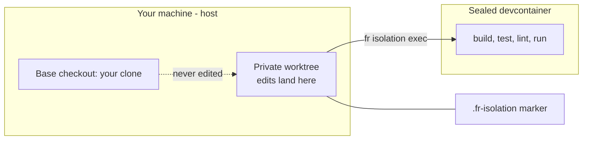

## Overview: two boundaries and a bridge

Hand an autonomous agent write access to your real checkout and two things go wrong
fast: it collides with your in-flight work, and its generated commands inherit your full
credentials. fr-isolation removes both by construction.

Every run is nested inside two independent boundaries. A **git worktree**, a throwaway
copy of the repo physically outside your clone, absorbs all the checkouts, stashes and
commits. A **devcontainer** wraps execution, so generated code only ever sees the
credentials that workspace was explicitly granted. File edits land on the host-visible
worktree; everything runnable is funnelled into the container through one command, the
exec-bridge.

Isolation is not asked for. It is the only door in.

Two docker-less modes sit beside the default for hosts and pods with no container
runtime: **host-worktree** (`FR_ISOLATION_TARGET=worktree`: the worktree, the host's own
environment, no profile) and **external**, where the environment's preparer writes the
marker itself and fr adopts it. The worktree boundary and the edit gate are the same in
all three.

## How it works: where the work lives, where it runs

The base checkout is never a participant. Edits happen on the worktree; execution is
proxied into the sealed container; a small marker file ties the whole thing to the
enforcement layer.



| Boundary | What it is | What it guarantees |
|---|---|---|
| Workspace isolation | A real linked worktree cut from the committed tree, at `~/.cache/fr/worktrees/<repo>/<branch>`: its own branch, outside the base clone. | Your clone is never touched. |
| Environment isolation | A sealed devcontainer started from a committed profile, with scoped credentials only: no SSH identity and no git-host tokens unless the profile grants them, so a push cannot originate here. Before `up` reports it ready, fr also runs `fr --version` inside it, so a failed tool install stops startup there. | The agent only holds what the workspace was granted. |

The marker closes the loop. On `up`, fr writes `.fr-isolation` into the worktree root and
adds it to the repo's exclude list: gitignored, never committed, backed by a CI tripwire.
Every edit the agent attempts is checked against it.

## Who creates worktrees

Four things can create a worktree. fr owns or routes all of them, and knows which agent
session holds each workspace.

| Creator | Location | State and session link |
|---|---|---|
| `fr isolation up` | `~/.cache/fr/worktrees/<main-checkout>/<branch-slug>`, keyed on the main checkout even when run from inside another worktree | `<common-dir>/fr/isolation/<slug>.json`, plus a per-session index at `~/.cache/fr/sessions/<session-id>.json` |
| Claude Code's own worktree commands (`claude --worktree <name>`, `EnterWorktree`) | the same fr location, on branch `wt/<name>`, because the plugin's `WorktreeCreate` hook calls `fr isolation up` | fr state, with the session bound in the same call |
| A subagent started with `isolation: "worktree"` (`agent-*` names) | `~/.cache/fr/agent-worktrees/<main-checkout>/agent-<id>`, a detached worktree outside the repo | none; `fr isolation gc` removes the finished, clean ones |
| superpowers' `using-git-worktrees` | routed to `fr isolation up` by the shipped rule `fr-worktree-override.md`; `<repo>/.worktrees/` is never created | fr state |

`fr isolation status` lists the sessions holding each workspace. The shipped script
`plugins/super-fr/scripts/fr-statusline-segment.sh` prints the branch a session works on and
its worktree, green when it is an fr workspace and purple when not, and
`fr-statusline-claude.sh` is a ready-made Claude Code status line built on it.

In the default devcontainer mode, a repo with no profile is a stop, not a degraded mode (the
two docker-less modes above need none): the `fr-init` skill scans
the repo, interviews you about tools, credentials and working patterns, and scaffolds the
profiles with `fr init scaffold`. You pay that once per repo. And `fr isolation down` refuses
while the branch's PR is still open unless you pass `--force`, so cleanup cannot race your
final pushes.

## Enforcement: a staircase a faked marker can't climb

A `PreToolUse` hook runs on every edit tool call, in any session, forever. It accepts an
edit only if the marker survives a series of descending checks, each one written to defeat
a specific way of cheating. (On OpenCode and Hermes the same decision runs from their own
hook points; the shell is judged by a sibling guard while a pipeline is live.)

1. **Is there a `.fr-isolation` marker at the file's git root?** If not, and the path is
   not on the allow-list, the edit is refused outright.
2. **Does the marker's recorded root match the actual root?** This defeats a worktree
   copied elsewhere: the recorded path no longer resolves to here.
3. **Is the mode one fr knows?** `worktree` (devcontainer or host-worktree) and `external`
   are valid; anything unknown or mistyped fails closed rather than being waved through.
4. **Does the mode's own check pass?** For `worktree`, the toplevel must be a genuine linked
   worktree (`git-common-dir` differs from `git-dir`), which defeats a marker copied into
   your base clone, where those two paths are identical, so even a byte-perfect forgery
   fails. For `external`, the toplevel match must come with container evidence
   (`/.dockerenv`, `/run/.containerenv` or `$KUBERNETES_SERVICE_HOST`), so a marker forged
   on a bare host never validates.
5. **For `worktree`: is HEAD still on the marker's branch?** This defeats a workspace that
   drifted: a `git checkout -b` inside it leaves fr's state describing one branch while you
   edit another. A detached HEAD, as in the middle of a rebase, still passes, and the way
   back (`git switch <registered branch>`) is never blocked.

Only a marker that clears every step allows the edit. There are three ways around the
gate, all deliberate:

- **`FR_BASE_OK=1`**: a one-shot environment override for a deliberate, knowing edit to the
  base clone.
- **`.fr-isolation-allow`**: a root glob-list for operator-managed paths (data, caches,
  memory) that legitimately live outside isolation.
- **Self-heal**: the Bash guard's sentinel records every workspace your session bound. It
  stays armed while any survives, and retires once they are all gone, so you are never
  deadlocked.

The gate answers one question only: is this fr work happening in an fr-enabled repo's base
clone instead of its workspace? It is not a filesystem sandbox or a credential boundary,
and it says nothing about paths outside an fr-enabled repo.

## Tradeoffs: three scars, each a shipped bug

The sharp edges of isolation were not designed in the abstract. They are fixes, and the
design docs say so.

- **Committed, not written: the profile has to be on the branch.** A worktree is cut from
  the committed tree. A devcontainer profile that was only written to disk, never
  committed, silently vanished from the worktree, surfacing as a cryptic "config not
  found". Scaffolding now commits the profile by default; a write-only escape stays for the
  rare case.
- **Trust reality, not exit codes: teardown re-queries the world.** An early version
  believed docker's return codes and always deleted its state, so a transient hiccup left
  22+ orphaned containers across the operator's machine, invisible to `status`. Teardown
  now re-checks the actual post-condition: gone means gone, regardless of what an exit
  code claimed.
- **No new daemon: garbage collection without a scheduler.** "I don't want another
  scheduler on each host." So there is no cron. Instead every `up` and `down` fires a
  detached, best-effort sweep. Steady-state leakage is bounded to at most one stale
  workspace, host-wide, the accepted price of keeping the system daemon-free.

## Try it: drive the boundary by hand

The lifecycle is a plain-shell CLI any agent or human runs identically: edits on the host,
every command through the bridge.

```bash
fr isolation up --branch feat/rate-limit --profile dev   # worktree + container
fr isolation exec --branch feat/rate-limit -- uv run pytest -q
fr isolation status                                      # worktree, container, PR
fr isolation stop --branch feat/rate-limit               # free the container; the next exec resumes it
fr isolation rebuild --branch feat/rate-limit            # profile changed: new container, same worktree
fr isolation down --branch feat/rate-limit               # after the PR merges
```

The container is disposable; the worktree is the work. So the verbs that touch only the
container (`restart`, `stop`, `rebuild`) never touch your uncommitted files or the run's
cursor, and a changed profile is a rebuild, not a teardown. Even a forced `down` keeps fr's
own records under `docs/superpowers/` (unless you pass `--no-preserve`): it preserves them
inside the repository's git directory, and the `up --branch` that re-creates the worktree
puts them back. The restore only ever adds: a file that changed since the teardown is
reported as a conflict and its copy kept, a recorded deletion is reported but never
re-applied, and a different branch re-created under the same name gets nothing.

Or watch the boundary bite with no container at all: in any isolation-enabled repo, have an
agent edit a tracked file from the base clone with no active workspace. The hook refuses it
before the write touches disk. That single denial is the whole thesis: the sandbox is not a
suggestion the agent can drift out of, it is a gate it cannot walk around.

Back to the [fr overview](index.md).
