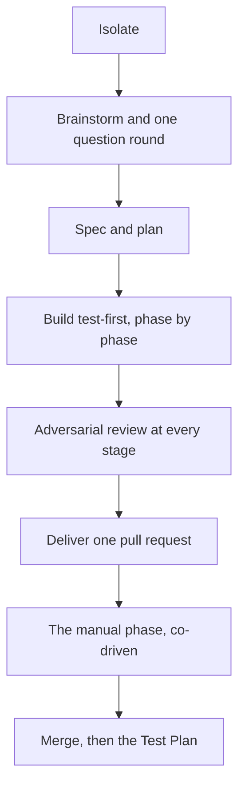

## The premise

You type a sentence, such as "add rate limiting to the webhook receiver", and an
agent designs it, builds it test-first, reviews its own work, and opens a single
pull request. Between those two moments sits everything that separates a demo
from something you would actually merge.

The interesting engineering in fr is not the writing. It is the scaffolding
around the writing: the guarantees that let you leave the room. Each feature
below earns its place by making the delivered PR trustworthy in one specific
way. Nothing is decoration.

Trust is not a vibe. fr assembles it, one guarantee at a time.

## The flow: /fr-goal

The same sequence runs every time, in an isolated workspace, and it pauses only
at the four moments where a human's judgment actually changes the outcome. The
diagram shows the order; the list under it says which steps are yours.



1. **Isolate (precondition).** Before the agent writes a single line, the run moves
   into a private workspace: a throwaway copy of the repo, its commands running in a
   sealed container by default. On a host without Docker, in a Claude Code cloud
   session, or in a container someone already prepared, the throwaway copy alone is the
   workspace. If the repo has no container profile in that default mode, the run stops
   and interviews you once. There is no "run it directly" fallback.
2. **Brainstorm and one question round (you decide).** The agent designs the feature
   and asks one question round sized to the feature, rarely two, and only when
   announced up front or you ask, then commits to a written spec. The record pins
   intent here, so nothing downstream has to guess what you meant.
3. **Spec, then plan (agent).** The design becomes a durable spec and a phase-by-phase
   plan stored in the repo. Both face review before anyone writes code, so review catches a
   bad plan while it is still cheap.
4. **Build, test-first, phase by phase (agent).** The agent writes each slice the
   disciplined way: the test first, then the code that satisfies it. Every command runs
   inside the workspace, never against your own checkout.
5. **Adversarial review at every stage (agent).** The spec and every implementation
   slice face an independent adversarial review whose job is to find what is wrong. A
   deterministic self-review checks the plan against the spec (on the light path, the
   spec reviewer reviews it too). The agent fixes every in-scope finding before the
   work moves on, never leaving it to a human's patience later. A finding this change
   did not cause becomes a tracked issue, listed in the PR.
6. **Deliver one pull request (agent).** The whole feature arrives as a single,
   coherent PR. The agent pushes and opens it through fr (`fr push`, `fr pr create`), so the repo's
   settings (`fr settings show`) can require it to ask you before the push and the PR,
   and can keep fr's labels, comments and issues off the forge. The agent never merges
   its own work: the pipeline keeps delivery and approval apart on purpose.
7. **The manual phase, co-driven (you and the agent).** Anything a machine should not do
   alone (secrets, a production toggle, a deploy) goes into a quarantined manual phase,
   by default the plan's last. The PR ships with it deliberately unfinished; you do that
   step, with the agent scaffolding and guiding it, and push to the same PR. When
   agentic work depends on it, it comes first instead, and the run pauses after a
   spec-and-plan PR.
8. **Merge, then the Test Plan (you and the agent).** You review and merge. If the change
   ships to real users, the spec carries a post-merge Test Plan the agent walks through
   with you. It runs the checks it can reach and you confirm the ones it cannot, before
   the workspace comes down.

## Why every feature exists: five guarantees

Read the pipeline again through this lens and it stops looking like ceremony. Every
step buys one of these properties for the code it produces.

### 1. Secure: the agent cannot touch what it should not

By default every run happens inside two nested boundaries. A private worktree leaves your
actual checkout alone: no stray branches, no half-finished state, nothing to clean up if
the run goes wrong. A sealed container means the commands the agent runs hold only the
credentials you explicitly granted that profile, and no SSH identity; pushes and PRs run
on your host with your own forge login. The two docker-less modes keep the worktree and
drop the container, so there the agent holds what the host process holds;
[fr-isolation](fr-isolation.md) explains all three.

- The default profile is least-privileged by convention: fr-init asks for no forge token
  for it, and the standard pipeline needs none. Credentials belong in a separate profile
  you select deliberately.
- There is no unisolated mode. A repo nobody has set up is a stop-and-configure moment,
  never a quiet fallback to running loose on your machine.

### 2. Correct: wrong is caught early, by something adversarial

fr defends correctness in three places at once. One operator gate (a question round sized
to the feature, rarely two) pins intent up front, so the build is not chasing a moving
target. Construction is test-first: the test specifies behaviour before the code exists.
And judgment comes from independent adversarial reviews at each meaningful stage.

- Independent reviews run against the spec and every implementation slice, not just once
  at the end; the plan gets a deterministic self-review against the spec.
- The agent fixes every in-scope finding before the work advances. A finding this change
  did not cause becomes a tracked issue, listed in the PR. Nothing rides along unrecorded.

### 3. Testable: proof the feature works, and stays honest

Two mechanisms carry testability past the merge. The post-merge Test Plan verifies the
change in the real world, co-driven so nothing that needs a human's eyes gets rubber-
stamped. The acceptance matrix tracks business-level truths ("an operator can do X") as
first-class, durable tests.

- Acceptance rows are born at design time, in the brainstorm record, defended one line
  each at spec review, and linked to the plan phases that satisfy them.
- Each row carries an honesty status (automated-and-cannot-drift, verified-but-manual,
  not-yet, or known-failing-on-purpose), so the matrix can never quietly overstate
  coverage.

### 4. Durable: the result survives contact with reality

Durability is about the work holding together after the excitement of the build. The
feature ships whole: the risky human step goes into a manual phase, by default the plan's
last, so it does not leave the PR half-integrated. Cleanup always happens, and guardrails
stop the classic after-the-fact mistakes.

- A merged-PR guard refuses pushes onto a branch whose PR has already closed, so a late
  commit cannot orphan itself off the main line.
- Close-out reconciles workspaces and tears them down, so an unattended run does not leave a
  graveyard of containers behind it.

### 5. Maintainable: the next person can follow what happened

Everything the agent does leaves a legible trail. The spec and plan live in the repo as
durable documents, not a chat log that scrolls away. Delivery is always a reviewable PR.
And the acceptance matrix doubles as living documentation of what the system actually
promises its users.

- New acceptance rows added mid-flight are diffable and defended in the PR: scope growth
  is visible, never silent.
- Plans are phase-by-phase artifacts, so picking the work back up later reads like a
  table of contents, not archaeology.

## Autonomy with seams

fr runs unattended almost end to end. It stays that way precisely because it does not try
to automate the four things a human should own; it designs clean seams around them
instead.

| Seam | When | What you do |
|---|---|---|
| The question round | once, up front | Answer the design questions in one round sized to the feature, before the build. A second round is announced up front or asked for by you, never a third. You set direction at one gate; the agent does not interrupt you eight times later. |
| The manual phase | back-loaded | Drive the secrets, deploys and UI operations isolated into a final phase, with the agent preparing and guiding the step rather than handing it off blind. |
| The merge | the gate | Approve. The agent delivers and you approve; keeping authorship and merge authority apart is the oldest safety rule in engineering, kept deliberately intact. |
| The Test Plan | after the fact | Confirm what the agent cannot reach in a co-driven post-merge walkthrough for anything that reaches real users. |

## Go deeper

- **The pipeline.** [fr-goal: one conversation, then a reviewed PR](01-fr-goal.md) is the
  full local flow, step by step: brainstorm, a question round sized to the feature, spec,
  plan, test-first build, review, merge, and the post-merge Test Plan.
- **The boundary.** [fr-isolation: the sandbox an agent cannot walk out of](fr-isolation.md)
  explains how fr makes "never touches your checkout" literally true: worktree, container,
  and a marker no copy can fake.
- **Coverage.** The [acceptance report](./acceptance/) lists every business-level promise
  and the proof behind it.

## Try it

In any repo (fr sets up the isolated workspace itself the first time), this is the entry
point to everything above:

```text
/fr-goal add rate limiting to the webhook receiver
```
