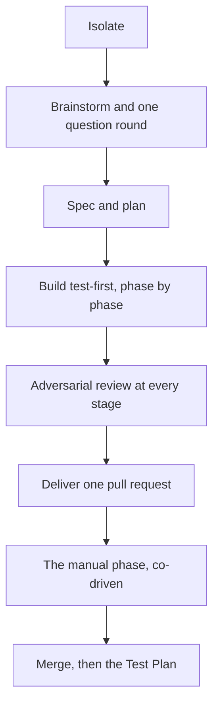

## The premise

You type a sentence, such as "add rate limiting to the webhook receiver", and an
agent designs it, builds it test-first, reviews its own work, and opens a single
pull request. Between those two moments sits everything that separates a demo
from something you would actually merge.

The interesting engineering in fr is not the writing. It is the scaffolding
around the writing: the guarantees that let you leave the room. Each feature
below earns its place by making the delivered PR trustworthy in one specific
way. Nothing is decoration.

Trust is not a vibe. It is assembled, one guarantee at a time.

## The flow: /fr-goal

The same sequence runs every time, in an isolated workspace, and it only pauses
at the four moments where a human's judgment actually changes the outcome. The
diagram shows the order; the list under it says which steps are yours.



1. **Isolate (precondition).** Before a single line is written, the run moves into
   a private workspace: a throwaway copy of the repo, with its commands running in a
   sealed container by default (on a host without Docker, or in a container someone
   already prepared, the throwaway copy alone is the workspace). If the repo has never been set up, the run stops and interviews
   you once. There is no "run it directly" fallback.
2. **Brainstorm and one question round (you decide).** The agent designs the feature
   and asks one question round sized to the feature, rarely two, and only when
   announced up front or you ask, then commits to a written spec. Intent is pinned
   here, on the record, so nothing downstream has to guess what you meant.
3. **Spec, then plan (agent).** The design becomes a durable spec and a phase-by-phase
   plan stored in the repo. Both are reviewed before anyone writes code, so a bad plan
   is caught while it is still cheap.
4. **Build, test-first, phase by phase (agent).** Each slice is written the disciplined
   way: the test first, then the code that satisfies it. Every command runs inside the
   workspace, never against your own checkout.
5. **Adversarial review at every stage (agent).** The spec, the plan and every
   implementation slice face an independent review whose job is to find what is wrong.
   Every finding is fixed before the work moves on, not deferred to a human's patience
   later.
6. **Deliver one pull request (agent).** The whole feature arrives as a single,
   coherent PR. It is pushed and opened through fr (`fr push`, `fr pr create`), so the
   repo's settings (`fr settings show`) can require it to ask you before the push and
   the PR, and can keep fr's labels, comments and issues off the forge. The agent never
   merges its own work: delivery and approval are kept
   apart on purpose.
7. **The manual phase, co-driven (you and the agent).** Anything a machine should not do
   alone (secrets, a production toggle, a deploy) is quarantined into the plan's final
   phase. The PR ships with it deliberately unfinished; you do that step, with the agent
   scaffolding and guiding it, and push to the same PR.
8. **Merge, then the Test Plan (you and the agent).** You review and merge. If the change
   ships to real users, the spec carries a post-merge Test Plan the agent walks through
   with you. It runs the checks it can reach and you confirm the ones it cannot, before
   the workspace is torn down.

## Why every feature exists: five guarantees

Read the pipeline again through this lens and it stops looking like ceremony. Every
step is buying one of these properties for the code it produces.

### 1. Secure: the agent cannot touch what it should not

By default every run happens in two nested boundaries. A private worktree means your actual
checkout is never touched: no stray branches, no half-finished state, nothing to clean
up if the run goes wrong. A sealed container means the agent only ever holds the
credentials that workspace was explicitly granted. The two docker-less modes keep
the worktree and drop the container, so there the agent holds what the host process
holds; [fr-isolation](fr-isolation.md) explains all three.

- The default workspace is least-privileged: it carries no tokens at all, and a
  privileged profile is a deliberate opt-in.
- There is no unisolated mode. A repo that is not set up is a stop-and-configure moment,
  never a quiet fallback to running loose on your machine.

### 2. Correct: wrong is caught early, by something adversarial

Correctness is defended in three places at once. Intent is pinned up front at one
operator gate (a question round sized to the feature, rarely two), so the build is not
chasing a moving target. Construction is test-first, so behaviour is specified before it
is implemented. And judgment comes from independent adversarial reviews at each
meaningful stage.

- Reviews run against the spec, the plan and every implementation slice, not just once at
  the end.
- Every finding is fixed before the work advances. There is no backlog of "known issues"
  quietly riding along in the PR.

### 3. Testable: proof the feature works, and stays honest

Two mechanisms carry testability past the merge. The post-merge Test Plan verifies the
change in the real world, co-driven so nothing that needs a human's eyes gets rubber-
stamped. The acceptance matrix tracks business-level truths ("an operator can do X") as
first-class, durable tests.

- Acceptance rows are born at design time, presented for defense in the same question
  round, and linked to the plan phases that satisfy them.
- Each row carries an honesty status (automated-and-cannot-drift, verified-but-manual,
  not-yet, or known-failing-on-purpose), so the matrix can never quietly overstate
  coverage.

### 4. Durable: the result survives contact with reality

Durability is about the work holding together after the excitement of the build. The
feature ships whole: the risky human step is back-loaded into the plan so the PR is never
left half-integrated waiting on it. Cleanup is guaranteed, and guardrails stop the classic
after-the-fact mistakes.

- A merged-PR guard refuses pushes onto a branch whose PR is already closed, so a late
  commit cannot orphan itself off the main line.
- Workspaces are reconciled and torn down, so an unattended run does not leave a graveyard
  of containers behind it.

### 5. Maintainable: the next person can follow what happened

Everything the agent does leaves a legible trail. The spec and plan live in the repo as
durable documents, not a chat log that scrolls away. Delivery is always a reviewable PR.
And the acceptance matrix doubles as living documentation of what the system actually
promises its users.

- New acceptance rows added mid-flight are diffable and defended in the PR: scope growth
  is visible, never silent.
- Plans are structured, phase-by-phase artifacts, so picking the work back up later reads
  like a table of contents, not archaeology.

## Autonomy with seams

fr is unattended almost end to end. It stays that way precisely because it does not try
to automate the four things a human should own; it designs clean seams around them
instead.

| Seam | When | What you do |
|---|---|---|
| The question round | once, up front | Answer the design questions in one round sized to the feature, before the build. A second round is announced up front or asked for by you, never a third. You set direction at one gate; the agent does not interrupt you eight times later. |
| The manual phase | back-loaded | Drive the secrets, deploys and UI operations isolated into a final phase, with the agent preparing and guiding the step rather than handing it off blind. |
| The merge | the gate | Approve. The agent delivers and you approve; keeping authorship and merge authority apart is the oldest safety rule in engineering, kept deliberately intact. |
| The Test Plan | after the fact | Confirm what the agent cannot reach in a co-driven post-merge walkthrough for anything that reaches real users. |

## Go deeper

- **The pipeline.** [fr-goal: one conversation, then a reviewed PR](01-fr-goal.md) is the
  full local flow, step by step: brainstorm, a question round sized to the feature, spec,
  plan, test-first build, review, merge, and the post-merge Test Plan.
- **The boundary.** [fr-isolation: the sandbox an agent cannot walk out of](fr-isolation.md)
  explains how "never touches your checkout" is made literally true: worktree, container,
  and a marker no copy can fake.
- **Coverage.** The [acceptance report](./acceptance/) lists every business-level promise
  and how it is proven.

## Try it

In any repo (fr sets up the isolated workspace itself the first time), this is the entry
point to everything above:

```text
/fr-goal add rate limiting to the webhook receiver
```
