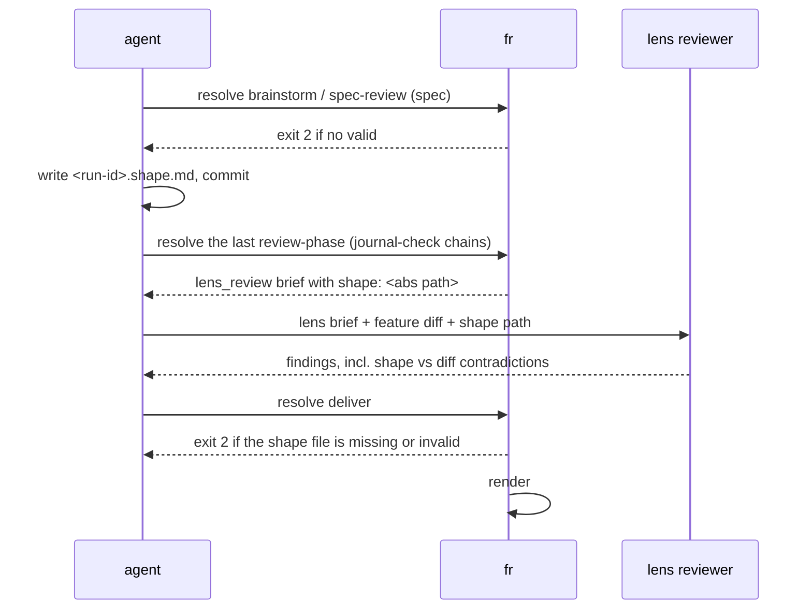

What the branch changes, by area (generated mirrors and fixture-only test edits folded):

```diff
 plugins/super-fr/
   skills/
+    fr-show-me/SKILL.md          # the visual vocabulary: trees, diffs, sequences, state, none
     fr-goal/SKILL.md             # + design shape in the spec, shape file before the last review resolve
     fr-brainstorming/SKILL.md    # + `## Design shape` in the spec
   agents/fr-spec-reviewer.md     # + 4th check: the shape matches the spec and the code
 packages/fr/src/fr/
+  shape.py                       # grammar, `## Design shape` reader, shape_path, refusals, shown_path
   commands/run_cmd.py            # + spec gate at brainstorm/spec-review/spec-plan-review; deliver refusal
   commands/skills_cmd.py         # + fr-show-me in `fr skills`
   record/pr_body.py              # + required `## Shape of the change`
   lenses/review.py               # + `shape` brief key and return-rule sentence
   run/adopt.py                   # + supersede moves <old-id>.shape.md
   archive.py                     # + _archive_shape (also on a partial-archive re-run)
   ops/trust.py                   # + <run-id>.shape.md is fr bookkeeping
   artifacts/registry.py          # agents kind 6 -> 7
   artifacts/agents_kind.py       # + the 6 -> 7 rerender hop
   agents/__init__.py             # CANONICAL_SHA256, PINNED_AT_VERSION 7
   artifacts/spec_test_plan_heading.py  # repair stops at `## Design shape`
 docs/
+  explainers/fr-show-me.md       # page for the new skill
   explainers/01-fr-goal.md       # the spec gate, the shape file, the PR section
   explainers/fr-brainstorming-and-plan.md  # + `## Design shape` in the spec
   review-lenses.md               # + the brief's `shape` key
 README.md                        # + fr-show-me in the skills table
 tests/unit/
+  test_shape.py, test_spec_design_shape_gate.py, test_pr_body_shape.py,
+  test_show_me_skill.py, test_show_me_pipeline_prose.py
```

Where the shape is checked in a run:


