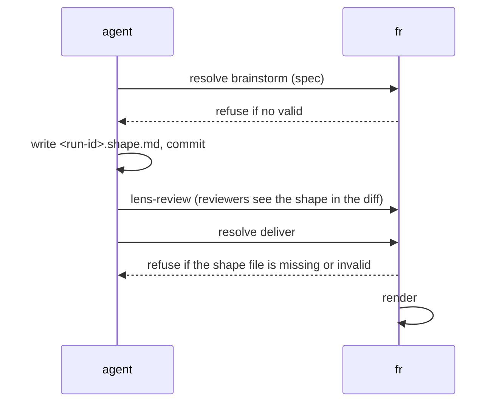

# Show me: a visual shape in every spec and every PR

Issue: derio-net/super-fr#1641.

## Background

Nothing in fr's pipeline helps a reader *see* a change. A spec is prose and lists; the PR body fr
renders (`packages/fr/src/fr/record/pr_body.py`, `render_pr_body`) is findings, owed rows and
tables; the diff tab shows lines, never which boundaries moved. The docs site has hand-made SVG
figures (`scripts/site/figures/`), but they are authored for explainers, not per change.

HumanLayer's `show-me` skill (github.com/humanlayer/skills, `plugins/show-me/skills/show-me/SKILL.md`,
MIT licence) answers this with prose alone: a menu of views ranked from cheapest — pseudocode, a
call tree, a component tree, a file tree with a responsibility comment per entry, mermaid, `diff`
blocks over *structure* (a tree, a call stack, a state flow), a whole target shape, and one HTML
page as a last resort — under one rule: pick the smallest view that makes the key point clear.
HumanLayer reuses the same text inside its PR-description and design-discussion skills.

Three facts of this repo shape the port:

- The OpenCode and Hermes mirrors (`scripts/sync-opencode.py`, `scripts/sync-hermes.py`) copy a
  skill's `SKILL.md` only. A reference file beside a skill never reaches them, so the vocabulary
  must BE a skill's `SKILL.md`.
- No skill may name a harness-specific tool (`fr.harness.prose.scan_prose`). HumanLayer's HTML route
  opens a browser with macOS `open`; it is left out.
- The PR body is fr's render from journals and records; the agent may only write above fr's
  marker. A visual that must be present has to be rendered by fr from a file, the way
  `<run-id>.pr-body.md` already lives beside the cursor and is archived with it
  (`fr.archive._archive_pr_body`).

Operator decisions (brainstorm, round 1): the vocabulary is a model-invocable skill,
`fr-show-me`; the PR section is fr-rendered and **required**; specs carry a **required**
`## Design shape` with a `none — <reason>` escape; verification is CI plus one post-merge `live`
row gated `tester`; accuracy is reviewed by `fr-spec-reviewer` (the spec's shape) and by the lens
reviewers, who see the run's shape file in the diff.

## Requirements

R1. A new skill, `fr-show-me` (`plugins/super-fr/skills/fr-show-me/SKILL.md`), holds the visual vocabulary: views ranked from cheapest — pseudocode, a call tree, an annotated file tree, a component tree, a structure-diff (a `diff` fenced block over a tree, call stack or state flow), a whole target shape, and mermaid — with the rules: pick the smallest view that makes the point, use one or several but never all, keep only what the current question needs, place each visual next to the short text it supports.
R2. `fr-show-me` is model-invocable (no flag that forbids it), so fr-goal and fr-brainstorming can point to it; the operator may also invoke it on demand to see the current topic.
R3. `fr-show-me` has no HTML or browser route and names no harness-specific tool, so it passes the tool-neutrality scan and reaches OpenCode and Hermes through the existing mirrors.
R4. `fr-show-me` tells the author to use this repo's own names, to redact any third-party host, org, repo or person per the third-party privacy rule, and to treat a visual as a claim about the code that must match it.
R5. `fr-show-me` credits HumanLayer's `show-me` skill (MIT) as its source.
R6. A **shape block** is Markdown whose content holds at least one fenced code block, or exactly one non-blank line of the form `none — <reason>` (a hyphen is accepted for the dash) with a non-empty reason. `fr.shape` owns this grammar, one function every check calls.
R7. A spec carries a `## Design shape` section whose body is a shape block.
R8. The `brainstorm` and `spec-review` resolves refuse, exit 2 and before anything is written, a spec with no `## Design shape` section or whose section is not a shape block, naming the spec and the two valid forms.
R9. A run's shape file is `<runs dir>/<run-id>.shape.md`, beside the cursor and following the placement; its content is a shape block showing the delivered change.
R10. The rendered PR body carries `## Shape of the change`, a required section: the shape file's content when it exists; `This run predates design shapes.` when the run's spec has no `## Design shape` section.
R11. `deliver` refuses, exit 2, when the run's spec has a `## Design shape` section and the shape file is missing or not a shape block, naming the path and the two valid forms.
R12. `fr archive` moves the shape file to the archive beside its cursor, as it does the durable PR body; the ops trust tree leaves it out as fr bookkeeping, as it does `<run-id>.pr-body.md`.
R13. `fr-spec-reviewer` checks the spec's `## Design shape` against the codebase and against the spec's own Design: every file, function or module the shape names exists (or the spec creates it), and the drawn change matches the text; a mismatch is a finding.
R14. fr-goal (both shapes) and fr-brainstorming tell the agent to write the spec's `## Design shape` with `fr-show-me`'s vocabulary, and to write and commit the run's shape file before dispatching the lens reviewers, so each lens reviewer sees it in the diff.
R15. An explainer page covers `fr-show-me`, the spec section and the PR section, and every docs page whose covered paths this change touches is updated or re-stamped.

## Design

### A. `fr-show-me` (R1–R5)

A new `plugins/super-fr/skills/fr-show-me/SKILL.md`, adapted rather than copied: the same ranked
menu, each view with a short example drawn from fr itself (an annotated `packages/fr/src/fr/` tree,
a structure-diff of a run's step list, a mermaid sequence of `resolve → advance → brief`). It adds
the two uses this repo has — a spec's `## Design shape` and a run's shape file — and the rule of
both: a shape block (R6), so `none — <reason>` is a legal answer when no picture helps.
Description triggers: "show me", "draw it", "visualize", "what does this look like", and the two
pipeline uses. The mirrors pick it up with `scripts/sync-opencode.py` and `scripts/sync-hermes.py`;
`scripts/install.sh` already loops over `skills/*/`; `scripts/sync-readme.py` regenerates the
README skills table.

### B. `fr.shape` (R6)

A small module, `packages/fr/src/fr/shape.py`:

- `is_shape_block(text) -> bool` and `shape_block_problem(text) -> str | None` (the one-line reason
  it is not one);
- `design_shape_section(spec_text) -> str | None` — the body under `## Design shape` up to the next
  `## ` heading outside a fence, `None` when the heading is absent;
- `shape_path(repo_root, run_id) -> Path` — `<runs dir>/<run-id>.shape.md`, through the same
  `kind_dir("run", space_for(repo_root))` the durable PR body uses.

### C. The spec gate (R7, R8)

`run_cmd._refuse_spec_policy` already runs at the two steps that accept a spec. A sibling,
`_refuse_spec_shape`, runs beside it on the same steps and the same spec path, refusing with the
spec path and the two forms. It is a run gate, not an artifact validator: the `spec` kind's shape
does not change, archived specs are untouched, and an in-flight run past `spec-review` is never
re-checked.

### D. The PR section and the deliver gate (R9–R11)

`render_pr_body` adds `## Shape of the change` after `## Out-of-scope findings` and before
`## Review lenses`; `REQUIRED_SECTIONS` gains the heading in that position. Its body: the shape
file's content; else, when the run's spec has no `## Design shape`, `This run predates design
shapes.`; else (only reachable if the gate below is bypassed) `No shape file was written.`
`deliver`'s refusals gain one: spec has the section and the shape file is missing or not a shape
block.

### E. Archive and trust (R12)

`fr.archive` gets `_archive_shape`, a twin of `_archive_pr_body` called beside it.
`fr.ops.trust`'s run-file predicate accepts `.shape.md` beside `.pr-body.md`, and its excluded-path
list names `<run-id>.shape.md`.

### F. Reviewer and skill prose (R13, R14)

`plugins/super-fr/agents/fr-spec-reviewer.md` gains the design-shape check. An agent edit moves the
`agents` artifact kind: `scripts/sync-agents-data.py`, the kind's `current_version`,
`fr.agents.CANONICAL_SHA256` and `PINNED_AT_VERSION`, a registered `rerender_migration` hop, then
`fr migrate artifacts --yes` and `scripts/sync-opencode.py` (AGENTS.md, "Skills/rules: canonical
source vs. generated mirrors"). fr-goal §1, §7a and §8, the light path, and fr-brainstorming §2 gain
one sentence each.

### G. Docs (R15)

`docs/explainers/fr-show-me.md` (plain-language standard, `covers:` the skill, `fr/shape.py` and
the PR section). `fr docs check` names the rest.

## Design shape

```diff
 plugins/super-fr/
   skills/
+    fr-show-me/SKILL.md        # the visual vocabulary (R1-R5)
     fr-goal/SKILL.md           # + design shape, shape file before lens-review (R14)
     fr-brainstorming/SKILL.md  # + `## Design shape` in the spec (R14)
   agents/
     fr-spec-reviewer.md        # + check the shape against the code (R13)
 packages/fr/src/fr/
+  shape.py                     # shape-block grammar, section reader, shape_path (R6)
   commands/run_cmd.py          # + _refuse_spec_shape at brainstorm/spec-review; deliver refusal (R8, R11)
   record/pr_body.py            # + `## Shape of the change`, required (R10)
   archive.py                   # + _archive_shape beside _archive_pr_body (R12)
   ops/trust.py                 # + .shape.md is fr bookkeeping (R12)
 docs/superpowers/runs/
+  <run-id>.shape.md            # written before lens-review, rendered at deliver (R9)
```



## Verification

strategy: none
- show-me-skill: none — unit tests pin the skill's presence, its mirrors and its tool neutrality in this PR's CI
- spec-design-shape-gate: none — unit tests drive the brainstorm and spec-review resolves over specs with and without the section
- pr-shape-section: none — unit tests render the PR body and drive deliver with and without the shape file
- shape-file-archived: none — unit tests run the archive and the trust predicate over a run with a shape file
- spec-reviewer-checks-shape: none — a unit test pins the reviewer's instruction; its effect on a real review is the live row's
- show-me-live-run: live — only a real fr-goal run after merge shows an agent writing an accurate shape into a spec and a PR
gate: developer
gate: show-me-live-run=tester

## Test Plan

- pre-merge — CI: `tests/unit/test_shape.py` pins the shape-block grammar and the section reader (R6), and the skill tests pin `fr-show-me`'s presence, mirrors, neutrality and credit (R1–R5) (rows `show-me-skill`).
- pre-merge — CI: resolve tests refuse a spec without a valid `## Design shape` at `brainstorm` and `spec-review` (R7, R8) (row `spec-design-shape-gate`).
- pre-merge — CI: PR-body and deliver tests cover the section, the predates text and the refusal (R9–R11) (row `pr-shape-section`).
- pre-merge — CI: archive and trust tests (R12) (row `shape-file-archived`); a text test pins the reviewer's instruction (R13) (row `spec-reviewer-checks-shape`).
- post-merge — operator-driven: run fr-goal on a real goal with the released build; its spec has a `## Design shape` that matches the code, and its PR shows a `## Shape of the change` that matches the diff (R13, R14) (row `show-me-live-run`).
